# Chen Notation Symbols

**Chen notation** (Peter Chen, 1976) is the classic *conceptual* ER notation. Entities are rectangles, attributes are ovals and relationships are diamonds. Every symbol below has its own small example.

> 🖊️ **Drawing note:** Mermaid has no native Chen mode, so these diagrams use flowchart shapes. Thick borders stand in for the *double* rectangle/diamond, and a double circle stands in for the double oval.

---

## 🟢 1. Strong Entity (Rectangle)

A **strong entity** exists on its own and has its own primary key.

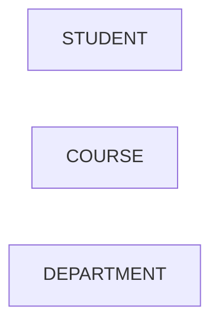

- **Becomes:** a table (`students`) or a collection.
- **Naming:** singular noun, UPPERCASE in diagrams.

---

## 🟢 2. Weak Entity (Double Rectangle)

A **weak entity** cannot be identified by its own attributes. It needs an **owner** entity.

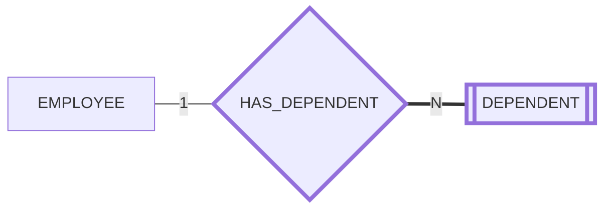

- **Example:** A `DEPENDENT` named "Riya" only makes sense *for a given employee*.
- **Becomes:** a table whose PK is `(employee_id, dependent_name)`.

---

## 🟢 3. Attribute (Oval)

An **attribute** is a single fact about an entity.

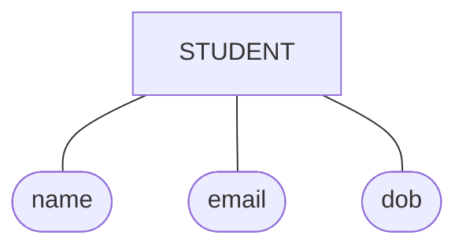

- **Becomes:** a column / document field.

---

## 🟢 4. Key Attribute (Underlined Oval)

The **key attribute** uniquely identifies each entity instance. Its name is **underlined**.

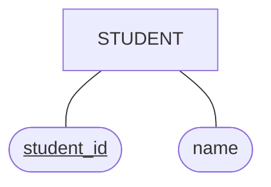

- **Becomes:** the `PRIMARY KEY` (or MongoDB `_id`).

---

## 🟢 5. Partial Key (Dashed Underline)

A **partial key** (discriminator) identifies a weak entity **only within its owner**.

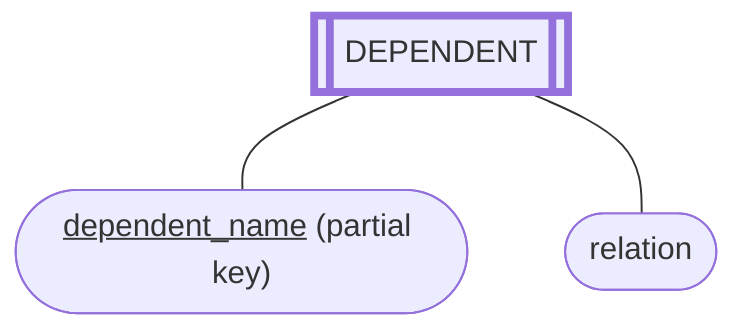

- **Becomes:** part of a composite PK together with the owner's key.

---

## 🟢 6. Multivalued Attribute (Double Oval)

A **multivalued attribute** can hold **many values** for one entity.

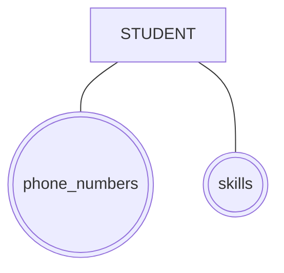

- **SQL:** move it to its own table → `student_phones(student_id, phone)`.
- **MongoDB:** store as an array → `phones: ["98...", "91..."]`.

---

## 🟢 7. Derived Attribute (Dashed Oval)

A **derived attribute** is **computed** from other attributes, so it is usually *not stored*.

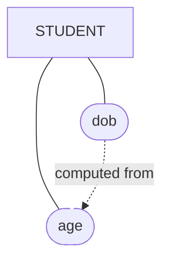

- **Becomes:** a query expression, a generated/virtual column, or a Mongoose virtual.

---

## 🟢 8. Composite Attribute (Oval with Child Ovals)

A **composite attribute** can be broken into smaller attributes.

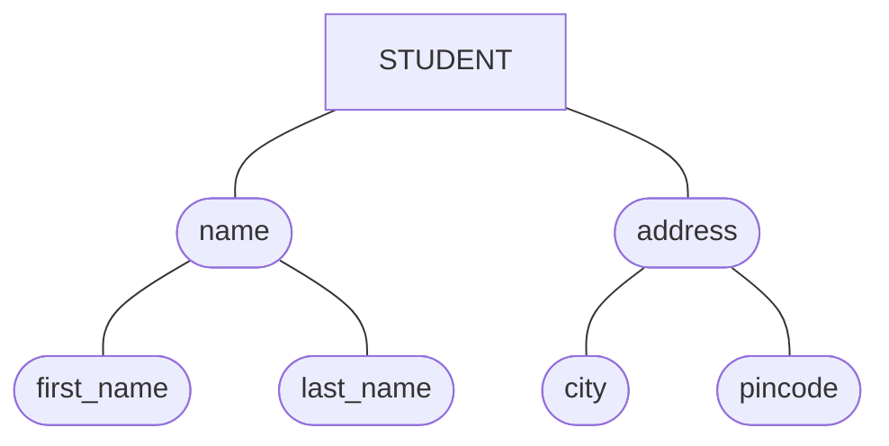

- **SQL:** store the leaf parts as columns (`first_name`, `last_name`).
- **MongoDB:** an embedded object → `name: { first, last }`.

---

## 🟢 9. Relationship (Diamond)

A **relationship** is an association between entities, named with a **verb**.

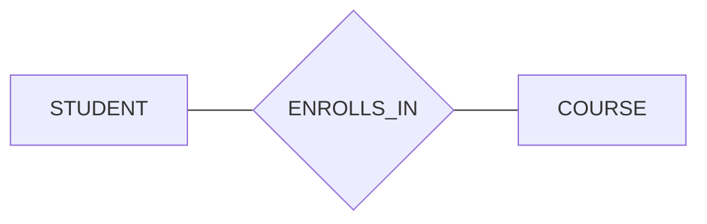

---

## 🟢 10. Identifying Relationship (Double Diamond)

An **identifying relationship** connects a **weak entity** to its **owner**. The owner's key becomes part of the weak entity's key.

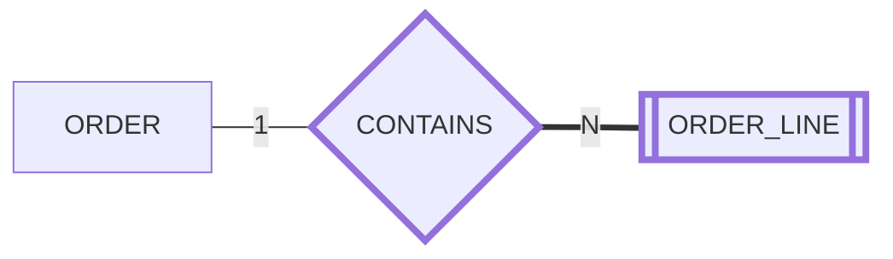

- **Becomes:** `order_lines(order_id, line_no, ...)` with `PRIMARY KEY (order_id, line_no)`.

---

## 🟢 11. Relationship Attribute (Oval on a Diamond)

Some facts belong to the **relationship**, not to either entity.

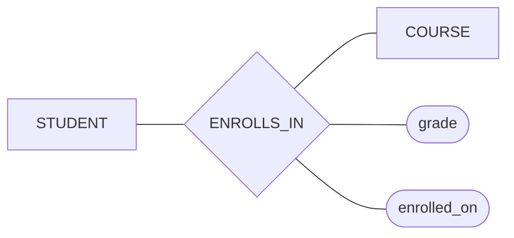

- **Becomes:** columns in the junction table `enrollments(student_id, course_id, grade, enrolled_on)`.

---

## 🟢 12. Cardinality Ratios (1, N, M labels)

The numbers on the lines tell you **how many** instances can take part.

### 1 : 1
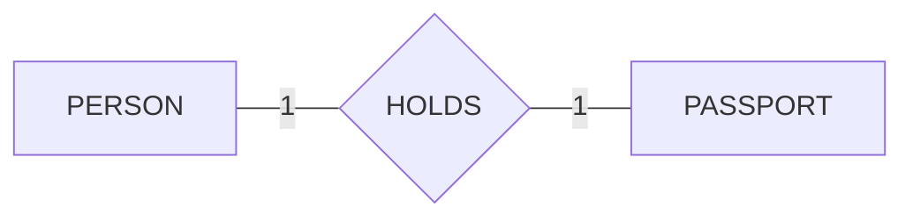

### 1 : N
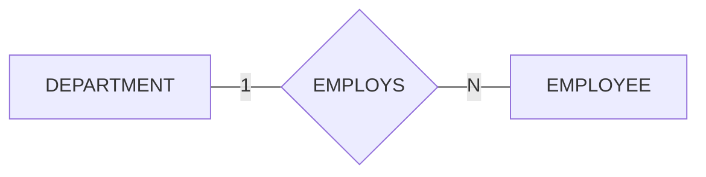

### M : N
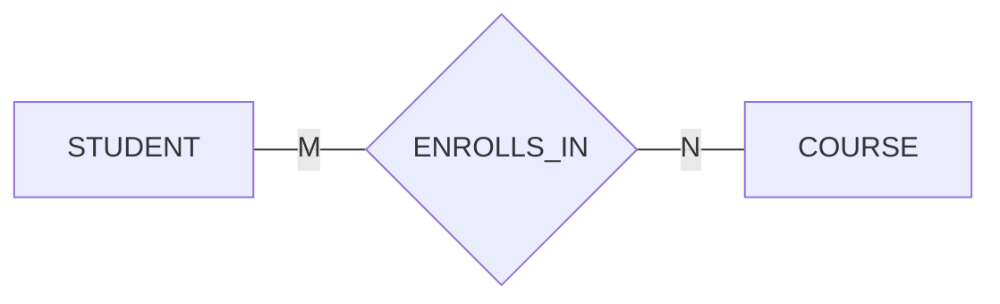

---

## 🟢 13. Participation (Single vs Double Line)

- **Partial participation (single line `──`)** → optional: *some* instances take part.
- **Total participation (double line `══`)** → mandatory: *every* instance must take part.

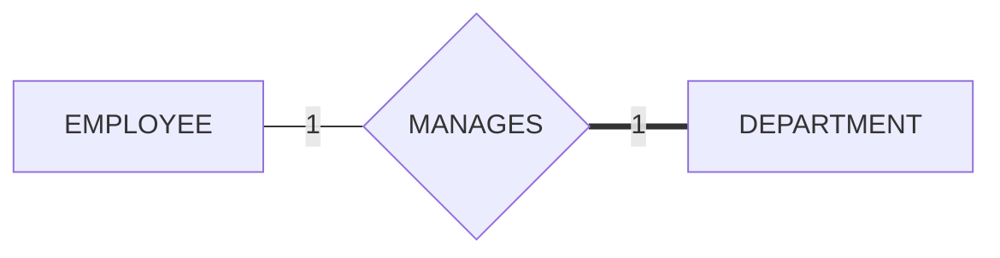

**Read it as:** not every employee manages a department (single line), but **every department must have** a manager (double line).

- **SQL:** total participation → `NOT NULL` foreign key.

---

## 🟢 14. Specialization / Generalization (ISA Triangle)

**ISA** ("is a") shows a supertype and its subtypes. Subtypes inherit all supertype attributes.

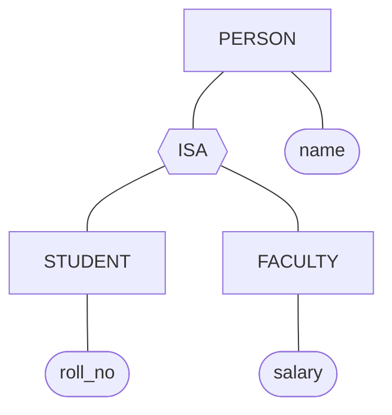

- **Disjoint (d):** a person is *either* a student *or* faculty.
- **Overlapping (o):** a person can be *both* (e.g. a PhD student who teaches).
- See **[Advanced ER Concepts](./03-Advanced-ER-Concepts.md)** for how to turn ISA into tables.

---

## 🌍 Putting It Together: Company Database (Chen)

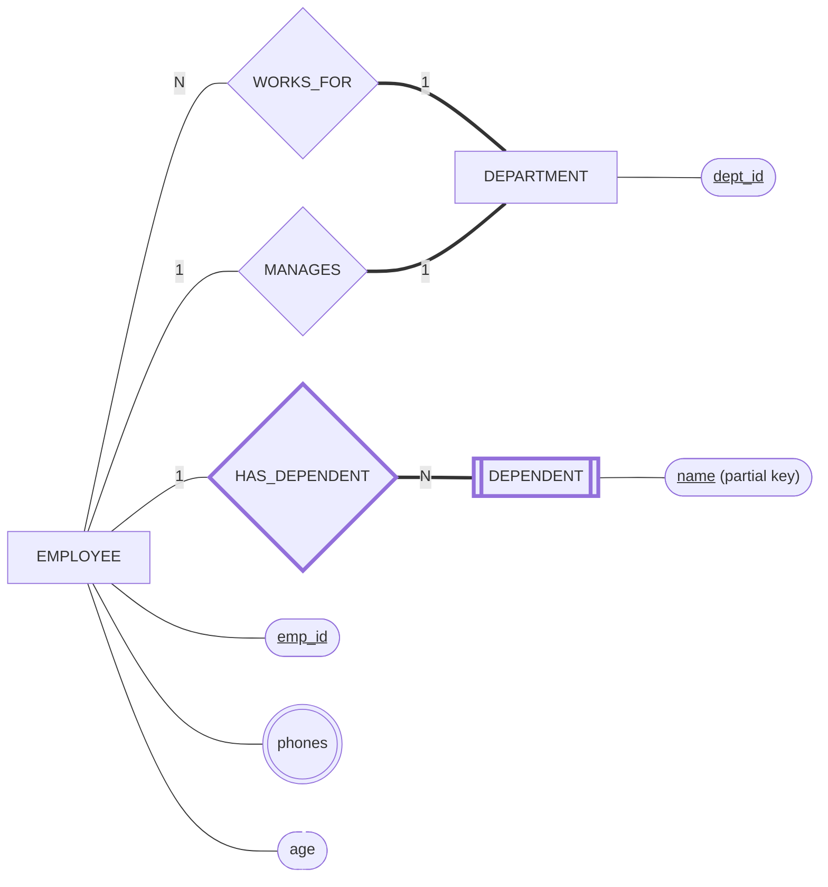

| Symbol used | Where |
| :--- | :--- |
| Strong entity | `EMPLOYEE`, `DEPARTMENT` |
| Weak entity + identifying relationship | `DEPENDENT` via `HAS_DEPENDENT` |
| Key / partial key | `emp_id`, `dept_id` / dependent `name` |
| Multivalued | `phones` |
| Derived | `age` |
| Total participation | Every employee works for a department; every department has a manager |

---

## 💡 Senior Engineer Tip:
"Chen diagrams get crowded fast. Use them for the first whiteboard session, then switch to **[Crow's Foot](./02-Crows-Foot-Notation.md)** once you start thinking about tables and keys."
