# Crow's Foot Notation

**Crow's Foot** (Information Engineering) notation is what you will see in almost every industry tool. Each end of a line carries **two marks**:

- The **inner mark** (closest to the line's middle) = **minimum**: `o` zero or `|` one.
- The **outer mark** (touching the entity) = **maximum**: `|` one or `<` many (the "crow's foot").

> 🧭 **Reading rule:** the symbol **next to an entity** tells you *how many of that entity* relate to **one** instance on the other side.

---

## 🟢 1. Exactly One `||`

**Minimum one, maximum one.** Mandatory and single.

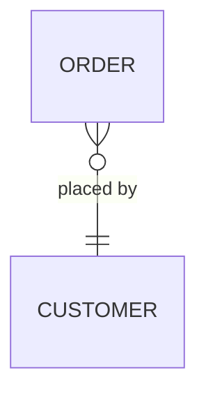

**Read it as:** each order is placed by **exactly one** customer.

```sql
customer_id INT NOT NULL REFERENCES customers(id)
```

---

## 🟢 2. Zero or One `|o` / `o|`

**Minimum zero, maximum one.** Optional and single.

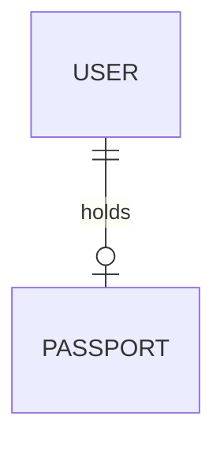

**Read it as:** a user holds **zero or one** passport; a passport belongs to exactly one user.

```sql
CREATE TABLE passports (
  id      INT PRIMARY KEY,
  user_id INT NOT NULL UNIQUE REFERENCES users(id) -- UNIQUE keeps it "max one"
);
```

---

## 🟢 3. One or Many `}|` / `|{`

**Minimum one, maximum many.** Mandatory and multiple.

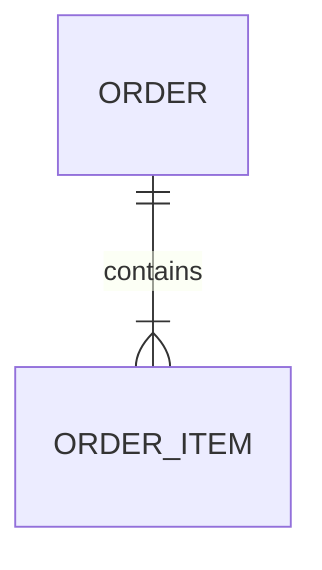

**Read it as:** an order contains **at least one** item.

- ⚠️ SQL can't force "at least one child" with a constraint alone. Enforce it in a **transaction** (insert order + items together) or in application logic.

---

## 🟢 4. Zero or Many `}o` / `o{`

**Minimum zero, maximum many.** Optional and multiple. The most common marker.

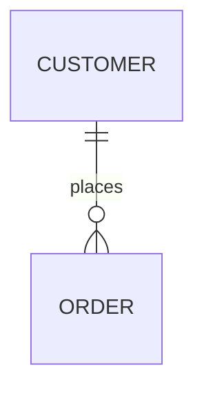

**Read it as:** a customer places **zero or more** orders (a new customer has none yet).

```sql
CREATE TABLE orders (
  id          INT PRIMARY KEY,
  customer_id INT NOT NULL REFERENCES customers(id)
);
```

---

## 🟢 5. All Four Markers Side by Side

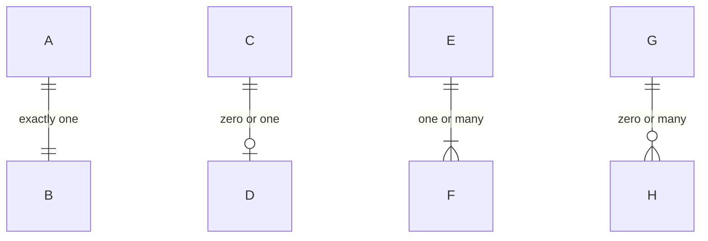

| Mermaid (left side) | Mermaid (right side) | Min | Max |
| :--- | :--- | :--- | :--- |
| `\|\|` | `\|\|` | 1 | 1 |
| `\|o` | `o\|` | 0 | 1 |
| `}\|` | `\|{` | 1 | many |
| `}o` | `o{` | 0 | many |

---

## 🟢 6. Relationship Types in Crow's Foot

### One-to-One (1:1)
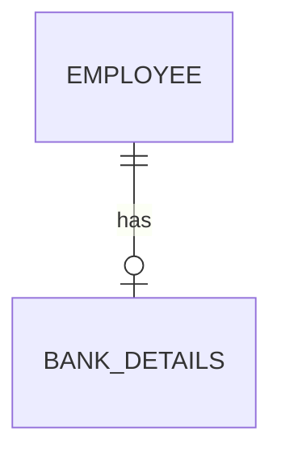

### One-to-Many (1:N)
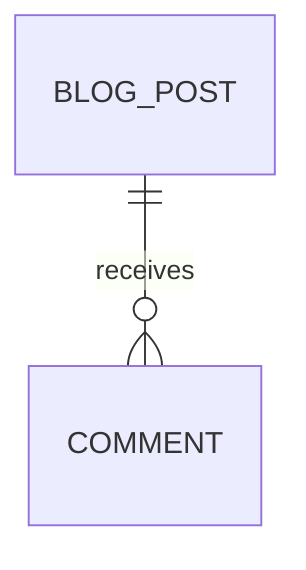

### Many-to-Many (M:N) → resolved with a junction table
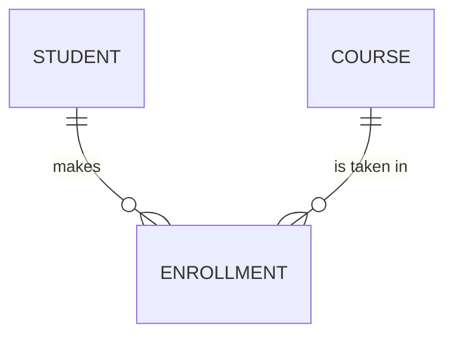

> Relational databases can't store M:N directly. The junction entity (`ENROLLMENT`) turns it into **two 1:N** relationships.

---

## 🟢 7. Identifying (Solid) vs Non-Identifying (Dashed) Lines

| Line | Mermaid | Meaning | Child's primary key |
| :--- | :--- | :--- | :--- |
| Solid `──` | `--` | **Identifying**: child can't exist or be identified without the parent | Includes the parent's key |
| Dashed `┄┄` | `..` | **Non-identifying**: child has its own identity | Its own `id`; parent key is a plain FK |

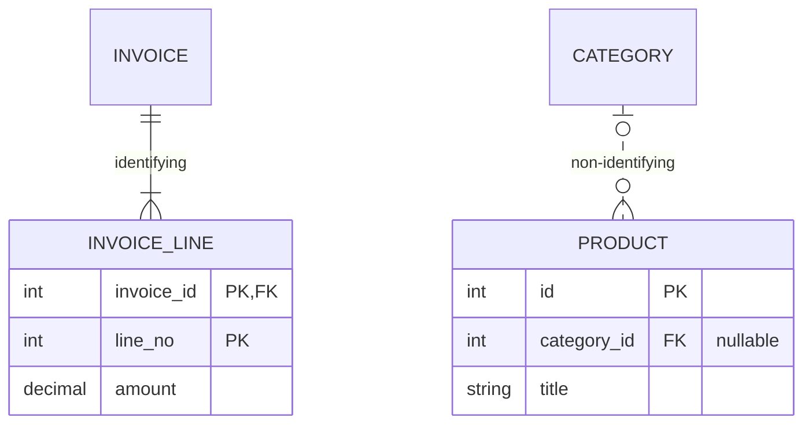

---

## 🟢 8. Attributes and Keys (PK, FK, UK)

Inside each entity box you list **type, name, key and an optional comment**.

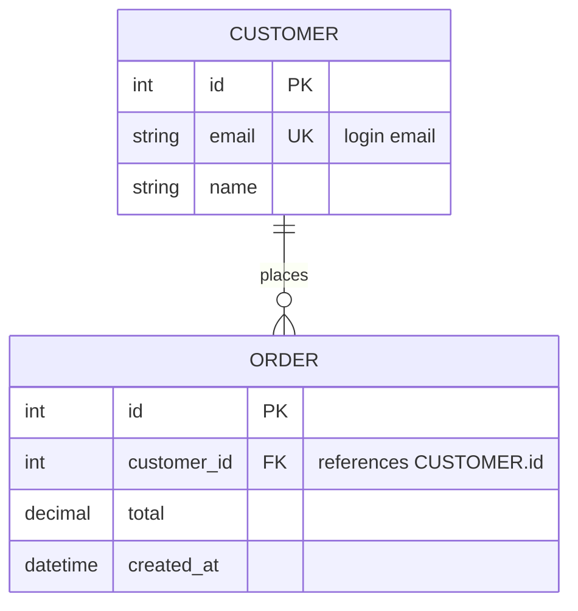

| Key | Meaning | SQL |
| :--- | :--- | :--- |
| `PK` | Primary key | `PRIMARY KEY` |
| `FK` | Foreign key | `REFERENCES other(id)` |
| `UK` | Unique key | `UNIQUE` |
| `PK, FK` | Part of a composite PK *and* a foreign key | `PRIMARY KEY (a, b)` + `REFERENCES` |

---

## 🟢 9. Self-Referencing (Recursive) Relationship

An entity related to **itself**.

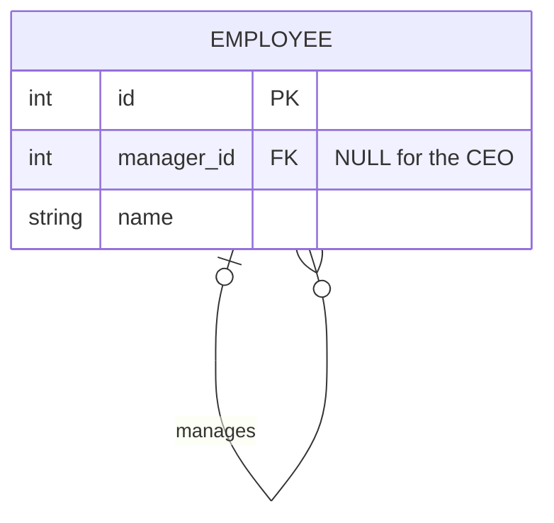

**Read it as:** an employee manages zero or more employees, and has zero or one manager.

---

## 🟢 10. Chen ↔ Crow's Foot Cheat Sheet

| Chen | Crow's Foot |
| :--- | :--- |
| `1` + single line (partial) | `\|o` zero or one |
| `1` + double line (total) | `\|\|` exactly one |
| `N` + single line (partial) | `o{` zero or many |
| `N` + double line (total) | `\|{` one or many |
| Diamond | Line with a verb label |
| Double diamond + weak entity | Solid (identifying) line, child PK includes parent key |
| Attribute ovals | Rows inside the entity box |

---

## 💡 Senior Engineer Tip:
"Always say the relationship **out loud in both directions** before you draw it: *'A customer places zero or many orders. An order is placed by exactly one customer.'* If either sentence sounds wrong, your symbols are wrong."
