# Advanced ER Concepts

Beyond basic entities and lines, real systems need **weak entities, associative entities, recursive and ternary relationships, and inheritance**. Each concept below is shown in both notations where it helps.

---

## 🟢 1. Weak Entity in Crow's Foot

In Chen it is a double rectangle. In Crow's Foot it is a **solid (identifying) line** and a **composite primary key**.

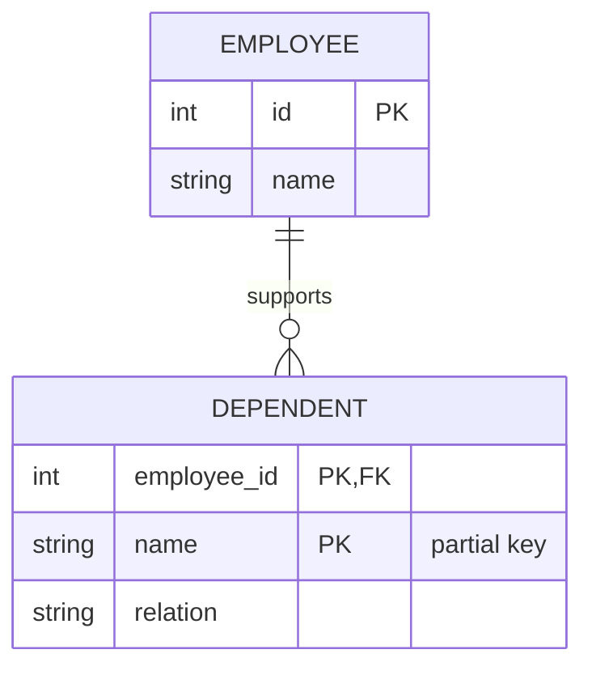

```sql
CREATE TABLE dependents (
  employee_id INT NOT NULL REFERENCES employees(id) ON DELETE CASCADE,
  name        VARCHAR(100) NOT NULL,
  relation    VARCHAR(30),
  PRIMARY KEY (employee_id, name)
);
```

- `ON DELETE CASCADE` → when the owner goes, the weak entity goes too.

---

## 🟢 2. Associative Entity (Junction with Its Own Data)

When an **M:N relationship has attributes**, it becomes an entity of its own.

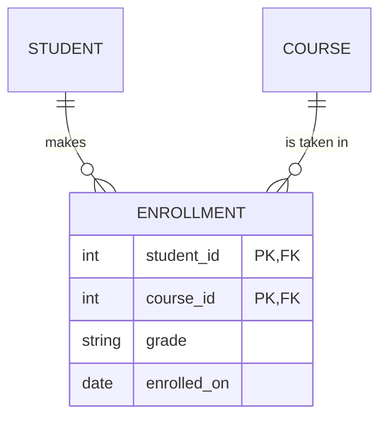

- **MongoDB:** keep it as a separate `enrollments` collection when it has its own data or grows without bound (see **[Many-to-Many](../relationship/many_to_many/many-to-many.md)**).

---

## 🟢 3. Recursive (Unary) Relationship

An entity related to **itself**: managers, folders, comment replies, category trees.

### Chen
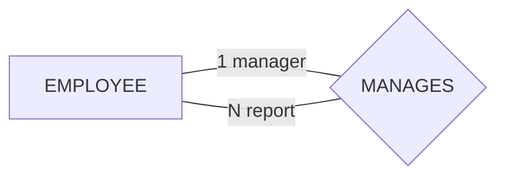

### Crow's Foot
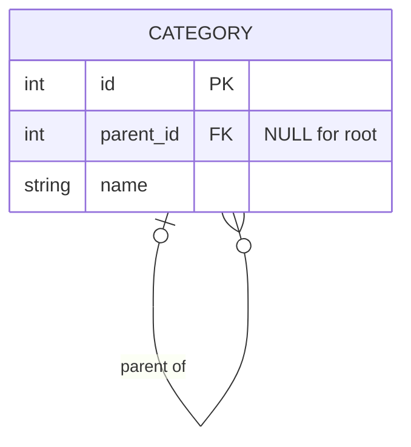

- **Role names** (`manager`, `report`) tell you which side is which.

---

## 🟢 4. Ternary Relationship (Three Entities)

Some facts need **three entities at once**: *a doctor prescribes a medicine to a patient*.

### Chen (one diamond, three lines)
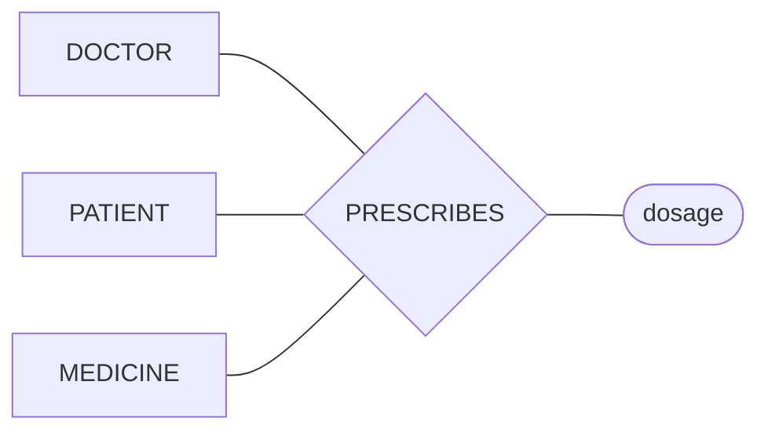

### Crow's Foot (resolve into an associative entity)
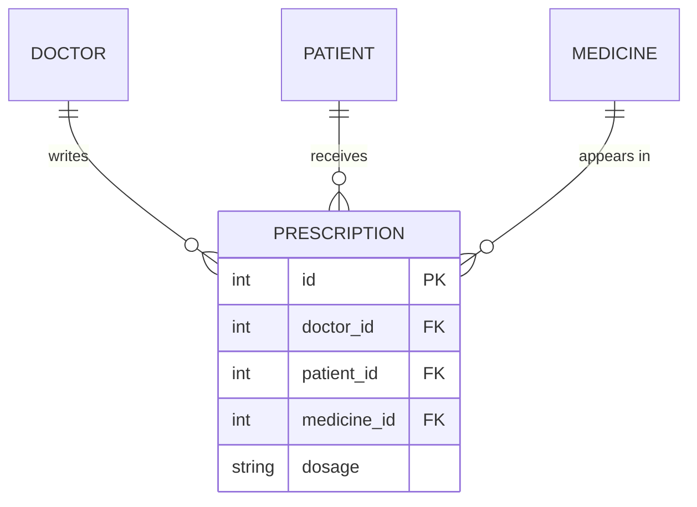

> ⚠️ Three separate binary relationships (doctor–patient, doctor–medicine, patient–medicine) **lose information**: you can no longer tell *which doctor* prescribed *which medicine* to *which patient*.

---

## 🟢 5. Specialization / Generalization (Inheritance)

### Chen / EER (ISA)
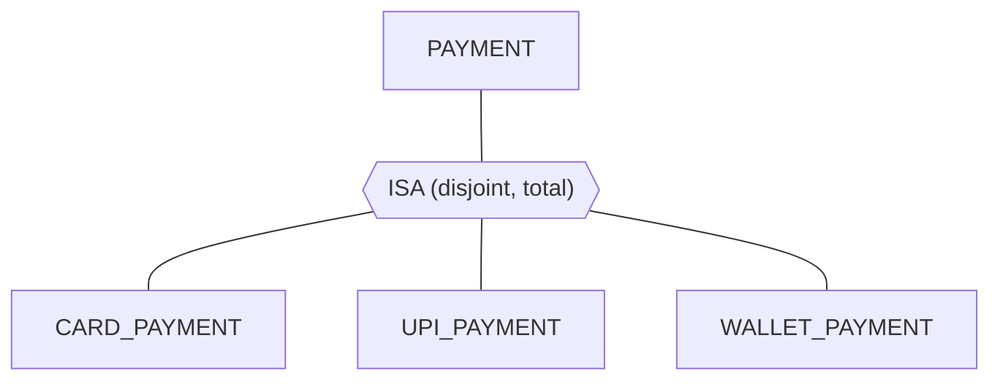

| Constraint | Meaning |
| :--- | :--- |
| **Disjoint (d)** | An instance belongs to **only one** subtype |
| **Overlapping (o)** | An instance can belong to **several** subtypes |
| **Total** (double line) | Every supertype instance **must** be in a subtype |
| **Partial** (single line) | A supertype instance **may** be in no subtype |

### Three ways to map ISA to tables

**a) Single table (one table + type column)**
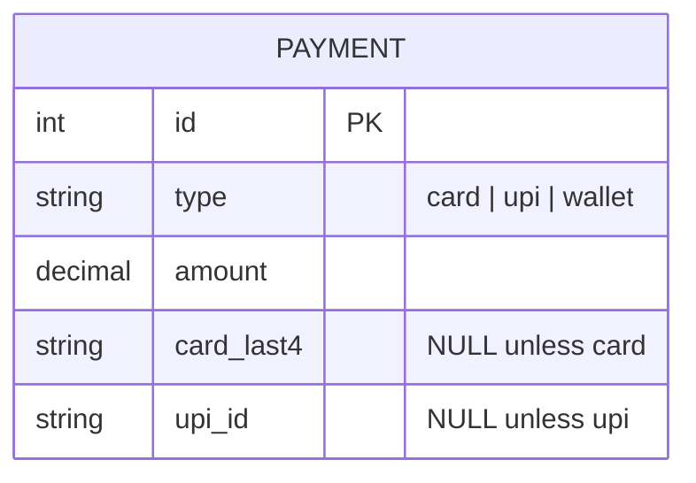

**b) Class table (supertype + one table per subtype, shared PK)**
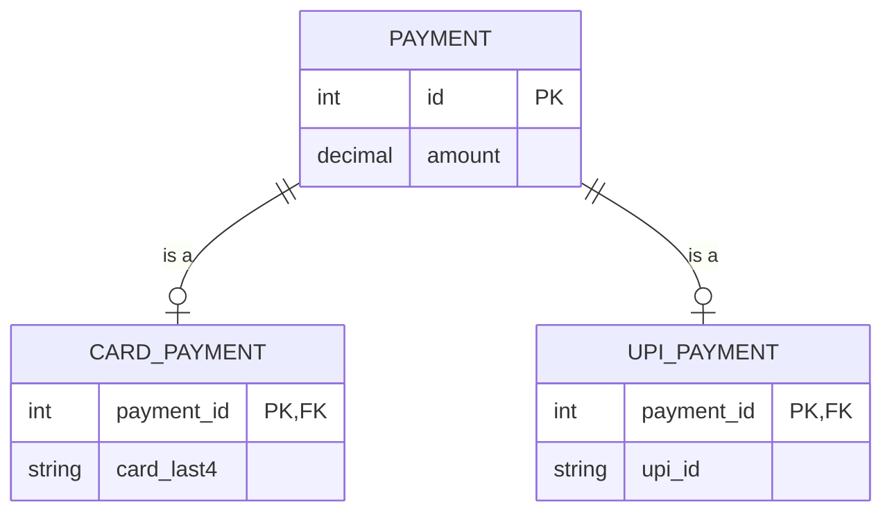

**c) Concrete table (one full table per subtype, no supertype table)**
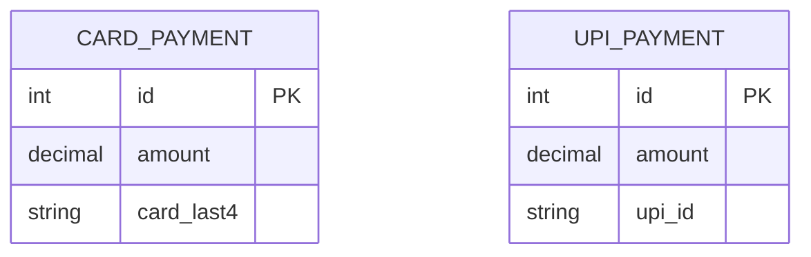

| Strategy | ✅ Pros | ❌ Cons |
| :--- | :--- | :--- |
| Single table | Fast reads, no joins | Many `NULL` columns, weak constraints |
| Class table | Clean, fully normalized | Join for every read |
| Concrete table | No joins, no `NULL`s | "All payments" query needs `UNION` |
| **MongoDB** | One collection with a `type` field (*polymorphic pattern*) | Validate each shape with schema validation |

---

## 🟢 6. Cardinality vs Participation (Min/Max Notation)

Some tools write `(min, max)` next to each entity instead of symbols.

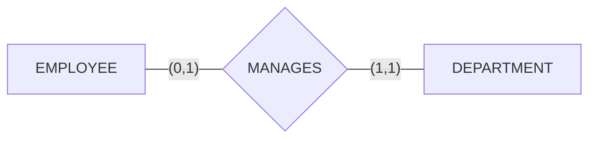

**Read it as:** an employee manages **0 to 1** departments; a department is managed by **exactly 1** employee.

| (min, max) | Crow's Foot |
| :--- | :--- |
| (0, 1) | `\|o` |
| (1, 1) | `\|\|` |
| (0, N) | `o{` |
| (1, N) | `\|{` |

---

## 💡 Senior Engineer Tip:
"If a relationship starts collecting its own attributes (dates, status, amounts), stop drawing it as a line. **Promote it to an entity.** It almost always becomes a table you will query on its own."
