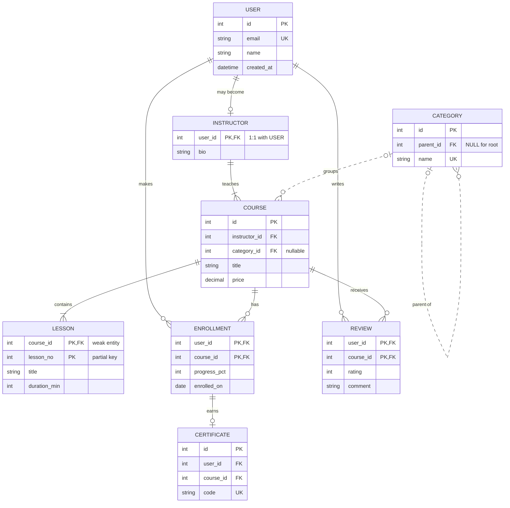
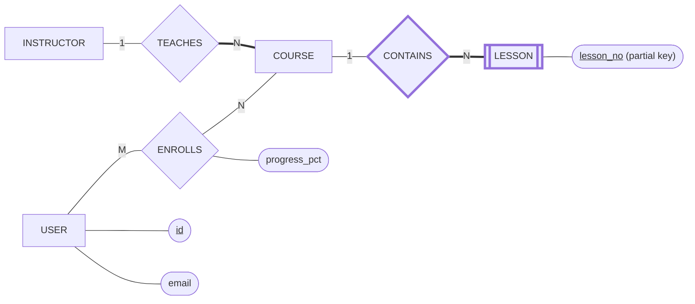

# Complete ER Example: Online Course Platform

One realistic diagram that uses **every Crow's Foot symbol**: all four cardinality markers, identifying and non-identifying lines, `PK` / `FK` / `UK`, a self-reference, a weak entity and an associative entity.

---

## 🟢 Requirements

1.  A **user** signs up with a unique email. Some users also have an **instructor profile**.
2.  An instructor **teaches** one or more **courses**. Every course has exactly one instructor.
3.  A course **contains** at least one **lesson**. Lessons are numbered inside their course.
4.  Courses can optionally belong to a **category**. Categories can be nested (parent → child).
5.  A user can **enroll** in many courses; an enrollment stores progress and may earn one **certificate**.
6.  A user can leave at most one **review** per course.

---

## 🟢 The ER Diagram



---

## 🟢 Symbol Legend for This Diagram

| Relationship | Symbol | Why |
| :--- | :--- | :--- |
| `USER` → `INSTRUCTOR` | `\|\|--o\|` exactly one → zero or one | Not every user teaches (optional 1:1) |
| `INSTRUCTOR` → `COURSE` | `\|\|--\|{` exactly one → one or many | An instructor exists because they teach ≥ 1 course |
| `CATEGORY` → `COURSE` | `\|o..o{` dashed, zero or one → zero or many | Category is optional, course has its own id (non-identifying) |
| `CATEGORY` → `CATEGORY` | `\|o..o{` self-reference | Nested categories; root has no parent |
| `COURSE` → `LESSON` | `\|\|--\|{` solid, one or many | **Weak entity**: lesson PK = `(course_id, lesson_no)` |
| `USER` / `COURSE` → `ENROLLMENT` | `\|\|--o{` zero or many | **Associative entity** resolving M:N, with its own data |
| `ENROLLMENT` → `CERTIFICATE` | `\|\|--o\|` zero or one | Only completed enrollments earn a certificate |
| `USER` / `COURSE` → `REVIEW` | `\|\|--o{` + composite PK | Composite PK enforces "one review per user per course" |

---

## 🟢 The Same Model as Chen (Conceptual View)



---

## 🟢 SQL Generated from the Diagram (MySQL)

```sql
CREATE TABLE users (
  id         INT PRIMARY KEY AUTO_INCREMENT,
  email      VARCHAR(255) NOT NULL UNIQUE,          -- UK
  name       VARCHAR(100) NOT NULL,
  created_at DATETIME DEFAULT CURRENT_TIMESTAMP
);

CREATE TABLE instructors (                            -- optional 1:1
  user_id INT PRIMARY KEY,
  bio     TEXT,
  FOREIGN KEY (user_id) REFERENCES users(id)
);

CREATE TABLE categories (                             -- self-reference
  id        INT PRIMARY KEY AUTO_INCREMENT,
  parent_id INT NULL,
  name      VARCHAR(100) NOT NULL UNIQUE,
  FOREIGN KEY (parent_id) REFERENCES categories(id)
);

CREATE TABLE courses (
  id            INT PRIMARY KEY AUTO_INCREMENT,
  instructor_id INT NOT NULL,                         -- exactly one
  category_id   INT NULL,                             -- zero or one (dashed line)
  title         VARCHAR(200) NOT NULL,
  price         DECIMAL(10,2) NOT NULL DEFAULT 0,
  FOREIGN KEY (instructor_id) REFERENCES instructors(user_id),
  FOREIGN KEY (category_id)   REFERENCES categories(id)
);

CREATE TABLE lessons (                                -- weak entity
  course_id    INT NOT NULL,
  lesson_no    INT NOT NULL,
  title        VARCHAR(200) NOT NULL,
  duration_min INT,
  PRIMARY KEY (course_id, lesson_no),
  FOREIGN KEY (course_id) REFERENCES courses(id) ON DELETE CASCADE
);

CREATE TABLE enrollments (                            -- associative entity (M:N)
  user_id      INT NOT NULL,
  course_id    INT NOT NULL,
  progress_pct TINYINT NOT NULL DEFAULT 0,
  enrolled_on  DATE NOT NULL,
  PRIMARY KEY (user_id, course_id),
  FOREIGN KEY (user_id)   REFERENCES users(id),
  FOREIGN KEY (course_id) REFERENCES courses(id)
);

CREATE TABLE certificates (                           -- zero or one per enrollment
  id        INT PRIMARY KEY AUTO_INCREMENT,
  user_id   INT NOT NULL,
  course_id INT NOT NULL,
  code      VARCHAR(40) NOT NULL UNIQUE,
  UNIQUE (user_id, course_id),
  FOREIGN KEY (user_id, course_id) REFERENCES enrollments(user_id, course_id)
);

CREATE TABLE reviews (
  user_id   INT NOT NULL,
  course_id INT NOT NULL,
  rating    TINYINT NOT NULL CHECK (rating BETWEEN 1 AND 5),
  comment   TEXT,
  PRIMARY KEY (user_id, course_id),
  FOREIGN KEY (user_id)   REFERENCES users(id),
  FOREIGN KEY (course_id) REFERENCES courses(id)
);
```

---

## 🟢 How Each Symbol Became a Constraint

| Diagram symbol | Constraint in SQL |
| :--- | :--- |
| `\|\|` exactly one | `NOT NULL` foreign key |
| `\|o` / `o\|` zero or one | Nullable FK, or FK + `UNIQUE` |
| `\|{` one or many | Not enforceable by a constraint → insert parent and children in one transaction |
| `o{` zero or many | Plain FK on the child, no extra rule |
| Solid (identifying) line | Parent key is part of the child's `PRIMARY KEY` |
| Dashed (non-identifying) line | Child has its own `id`; FK is a normal column |
| `UK` | `UNIQUE` |
| Self-reference | FK pointing at the same table |

---

## 💡 Senior Engineer Tip:
"Before you write any SQL, read every line of the diagram as two sentences. Then check that each sentence matches a constraint in the DDL. Any line without a matching constraint is a bug waiting to happen."
