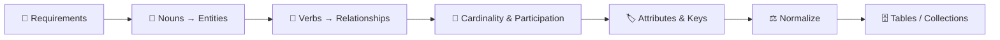

# 📐 ER Diagrams: Symbols & Notations

An **Entity-Relationship (ER) diagram** is a picture of your data model: the **things** you store (entities), the **facts** about them (attributes) and **how they connect** (relationships). You draw it *before* writing a single `CREATE TABLE` or Mongoose schema.

---

## 🟢 Why ER Diagrams Matter

1.  **Shared language** → Developers, PMs and DBAs can review the design without reading SQL.
2.  **Catch mistakes early** → A missing relationship is a 5-minute fix on paper and a painful migration in production.
3.  **Maps directly to code** → Entities become tables/collections, relationships become foreign keys/references.

---

## 🟢 The Two Notations You Will Meet

| Notation | Where you see it | Strength |
| :--- | :--- | :--- |
| **Chen** | Textbooks, university exams, conceptual design | Shows attributes, weak entities and participation very clearly |
| **Crow's Foot (IE)** | Industry tools: dbdiagram.io, MySQL Workbench, Lucidchart, Mermaid | Compact; cardinality is drawn at the end of each line |

> 💡 **Rule of thumb:** use **Chen** to *think* (conceptual model) and **Crow's Foot** to *build* (logical/physical model).

---

## 🟢 Complete Symbol Cheat Sheet

### Chen / EER symbols

| Symbol | Name | Meaning | Example |
| :--- | :--- | :--- | :--- |
| ▭ Rectangle | Strong entity | Exists on its own, has its own key | `STUDENT` |
| ▭ Double rectangle | Weak entity | Needs an owner entity to be identified | `DEPENDENT` of `EMPLOYEE` |
| ◯ Oval | Attribute | A property of an entity or relationship | `name` |
| ◯ Oval, underlined name | Key attribute | Uniquely identifies the entity | `student_id` |
| ◯ Oval, dashed underline | Partial key | Identifies a weak entity *within* its owner | `dependent_name` |
| ◎ Double oval | Multivalued attribute | Can hold many values | `phone_numbers` |
| ◌ Dashed oval | Derived attribute | Computed from other data, not stored | `age` (from `dob`) |
| ◯ Oval with child ovals | Composite attribute | Can be split into smaller parts | `name` → `first`, `last` |
| ◇ Diamond | Relationship | An association between entities | `ENROLLS` |
| ◈ Double diamond | Identifying relationship | Connects a weak entity to its owner | `HAS_DEPENDENT` |
| ── Single line | Partial participation | Participation is optional | Not every employee manages a dept |
| ══ Double line | Total participation | Participation is mandatory | Every dept must have a manager |
| `1`, `N`, `M` | Cardinality ratio | How many on each side | `1:N`, `M:N` |
| △ Triangle (ISA) | Specialization / Generalization | Subtype inherits from supertype | `STUDENT` ISA `PERSON` |

### Crow's Foot symbols (and their Mermaid code)

| Symbol | Mermaid (left / right) | Meaning | Read as |
| :--- | :--- | :--- | :--- |
| `+⎯⎯+` two bars | `\|\|` / `\|\|` | Exactly one | "one and only one" |
| `o⎯⎯+` circle + bar | `\|o` / `o\|` | Zero or one | "at most one" (optional) |
| `+⎯⎯<` bar + crow's foot | `}\|` / `\|{` | One or many | "at least one" |
| `o⎯⎯<` circle + crow's foot | `}o` / `o{` | Zero or many | "any number" (optional) |
| Solid line `──` | `--` | Identifying relationship | Child's PK includes the parent's key |
| Dashed line `┄┄` | `..` | Non-identifying relationship | Child has its own PK; FK is a normal column |
| `PK` / `FK` / `UK` | `PK`, `FK`, `UK` | Primary / Foreign / Unique key | `int id PK` |

---

## 🧭 From Requirements to Diagram

---

## 📂 Guides in this Section

1.  **[Chen Notation Symbols](./01-Chen-Notation-Symbols.md)** – Every Chen symbol with its own diagram.
2.  **[Crow's Foot Notation](./02-Crows-Foot-Notation.md)** – Cardinality markers, line styles and keys, each with SQL.
3.  **[Advanced ER Concepts](./03-Advanced-ER-Concepts.md)** – Weak entities, recursive, ternary, associative entities and inheritance.
4.  **[Complete ER Example](./04-Complete-ER-Example.md)** – One real-world diagram that uses every symbol, plus the SQL it produces.
