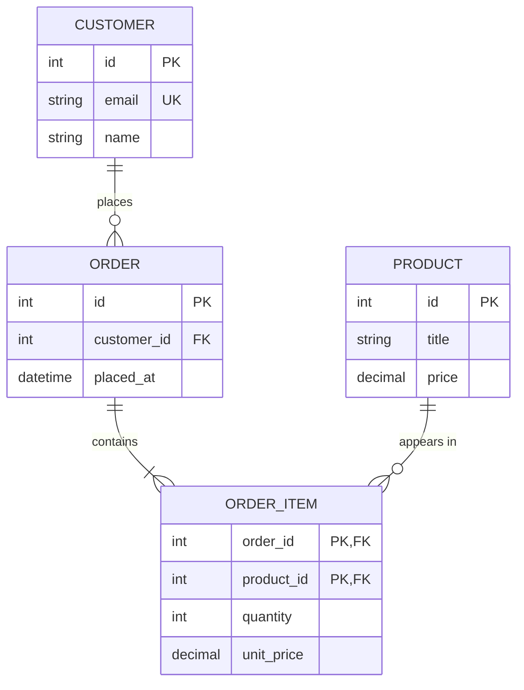
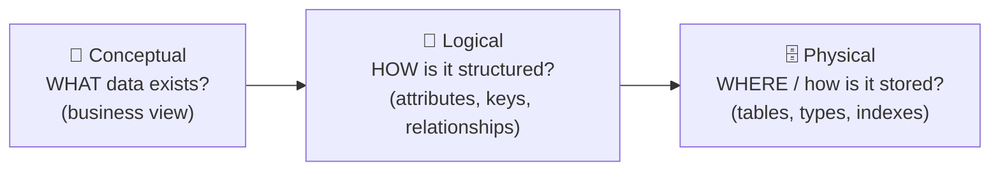
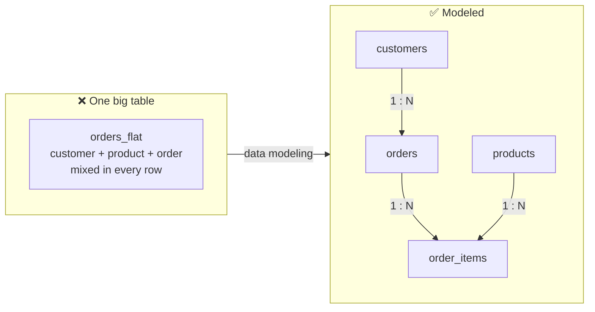
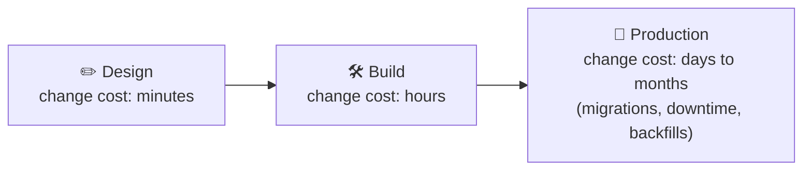
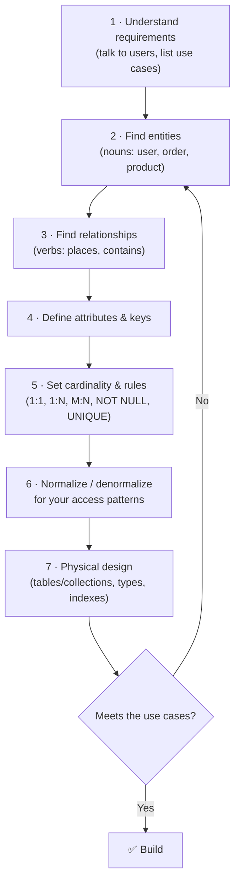

# 🌱 What is Data Modeling?

**Data modeling** is the process of deciding **what data your application stores, how it is structured, and how the pieces relate to each other** before (and while) you build it.

Think of it as the **blueprint of a house**. You would never start pouring concrete without knowing where the rooms, doors and pipes go. In the same way, you should not start writing `CREATE TABLE` or Mongoose schemas without knowing your entities, their fields and their relationships.

> 💡 **One-line definition:** a data model is a *map* of your data: the **things** (entities), their **facts** (attributes), the **links** between them (relationships) and the **rules** they must follow (constraints).

---

## 🟢 1. A Simple Example

Requirement: *"Customers place orders. Each order has one or more products."*

A data model turns that sentence into a clear structure:

From this one picture, everyone on the team knows:
- **Entities:** `CUSTOMER`, `ORDER`, `ORDER_ITEM`, `PRODUCT`.
- **Attributes and keys:** what each one stores and how it is identified.
- **Relationships:** a customer has many orders; an order has at least one item.
- **Rules:** an email must be unique; an item can't exist without its order.

---

## 🟢 2. The Three Levels of a Data Model

Data modeling moves from **business language** to **database code** in three steps.

| Level | Question it answers | Audience | Example output |
| :--- | :--- | :--- | :--- |
| **Conceptual** | *What* things does the business care about? | Product managers, stakeholders | "Customer places Order" |
| **Logical** | *How* are they structured and related? | Developers, architects | Entities with attributes, PK/FK, cardinality |
| **Physical** | *How* exactly is it stored in this database? | Backend engineers, DBAs | `CREATE TABLE`, data types, indexes, MongoDB collections |

> The **[ER Diagrams](../ER-Diagrams/README.md)** section shows how to draw the conceptual and logical levels.

---

## 🟢 3. What Problems Does Data Modeling Solve?

Without a model, data is usually dumped into one big table "for now". Here is what goes wrong.

### ❌ The "one big table" approach

| order_id | customer_name | customer_email | customer_city | product | price |
| :--- | :--- | :--- | :--- | :--- | :--- |
| 1 | Riya | `riya@mail.com` | Pune | Keyboard | 1500 |
| 2 | Riya | `riya@mail.com` | Pune | Mouse | 600 |
| 3 | Aman | `aman@mail.com` | Delhi | Keyboard | 1500 |

This looks fine on day one. Then the problems appear:

| Problem | What happens | Example |
| :--- | :--- | :--- |
| **Redundancy** | The same fact is stored many times | Riya's email is copied into every order she places |
| **Update anomaly** | Changing one fact means updating many rows; miss one and data disagrees | Riya moves to Mumbai: rows 1 and 2 must both change |
| **Insert anomaly** | You can't store a fact until another fact exists | You can't add a new customer until they place an order |
| **Delete anomaly** | Deleting one fact accidentally deletes another | Delete Aman's only order and you lose Aman completely |
| **Inconsistent data** | No rules, so bad values slip in | `price = -50`, `email = "abc"`, duplicate customers |
| **Slow queries** | Huge, wide rows and no clear keys to index | "Total spend per customer" scans the whole table |

### ✅ The modeled approach

Split the data by **what it describes**, and connect the pieces with **keys**:

| Problem | How the model fixes it |
| :--- | :--- |
| Redundancy | Each fact lives in **one place** (Riya's email is stored once in `customers`) |
| Update anomaly | Change the city **once**; every order sees it through the foreign key |
| Insert anomaly | Customers and products can exist **before** any order |
| Delete anomaly | Deleting an order doesn't delete the customer |
| Inconsistent data | Constraints: `UNIQUE(email)`, `CHECK(price > 0)`, `NOT NULL`, foreign keys |
| Slow queries | Clear keys and access paths make **indexing** straightforward |

---

## 🟢 4. Why Do We Need to Know Data Modeling?

### 1. The data outlives the code
You can rewrite an API in a weekend. **Migrating millions of rows** from a bad schema can take months. The model is the hardest part of a system to change later.

### 2. Performance starts with the model
Indexes, caching and bigger servers only help so much. If the structure forces a 5-table join or a 16MB MongoDB document on every request, **no amount of tuning will fix it**. Good models make fast queries the *default*.

### 3. Data integrity = user trust
Wrong balances, duplicate orders, missing records: users forgive slow pages, not lost or incorrect data. Keys and constraints from the model are your **last line of defense**.

### 4. It makes teams faster
A clear model is shared documentation. New developers, frontend teams, analysts and QA all understand the system from one diagram instead of reverse-engineering the code.

### 5. It is how you choose between SQL and NoSQL
You can't pick a database (or decide *embed vs reference* in MongoDB) until you know your entities, relationships and **access patterns**.

| | Relational (SQL) | Document (MongoDB) |
| :--- | :--- | :--- |
| **Model around** | Entities and their relationships | How the app **reads and writes** data (queries) |
| **Default style** | Normalize, then join | Embed what is read together, reference the rest |
| **Integrity** | Enforced by the database (FK, CHECK) | Mostly enforced by the app + schema validation |

### 6. It is a core interview skill
"Design the database for Instagram / Uber / an LMS" is one of the most common **backend and system-design** interview rounds. Interviewers judge you on entities, relationships, keys and trade-offs: exactly what this course teaches.

---

## 🧭 The Data Modeling Process

---

## 📖 Key Terms You Will See in This Course

| Term | Meaning | Example |
| :--- | :--- | :--- |
| **Entity** | A thing you store data about | `User`, `Order` |
| **Attribute** | A fact about an entity | `email`, `price` |
| **Primary Key (PK)** | Uniquely identifies a record | `users.id` |
| **Foreign Key (FK)** | Points to a record in another table | `orders.user_id` |
| **Relationship** | How entities connect | User *places* Order |
| **Cardinality** | How many on each side | 1:1, 1:N, M:N |
| **Constraint** | A rule the data must follow | `UNIQUE(email)` |
| **Normalization** | Removing redundancy by splitting data | Separate `customers` from `orders` |
| **Denormalization** | Duplicating data on purpose for faster reads | Store `customer_name` on the order |
| **Access pattern** | How the app reads/writes data | "Get the last 10 orders of a user" |

---

## 🗺️ Where to Go Next

1.  **[One-to-One Relationships](../relationship/one_to_one/one-to-one.md)**: start with the building blocks.
2.  **[ER Diagrams](../ER-Diagrams/README.md)**: learn to draw what you design.
3.  **[Normalization vs Denormalization](../Normalization-vs-Denormalization/Normalization-vs-Denormalization.md)**: the core trade-off behind every model.

---

## 💡 Senior Engineer Tip:
"Before writing any schema, list the **top 10 queries** your app will run. A data model is only good if it makes those queries simple, fast and correct."
