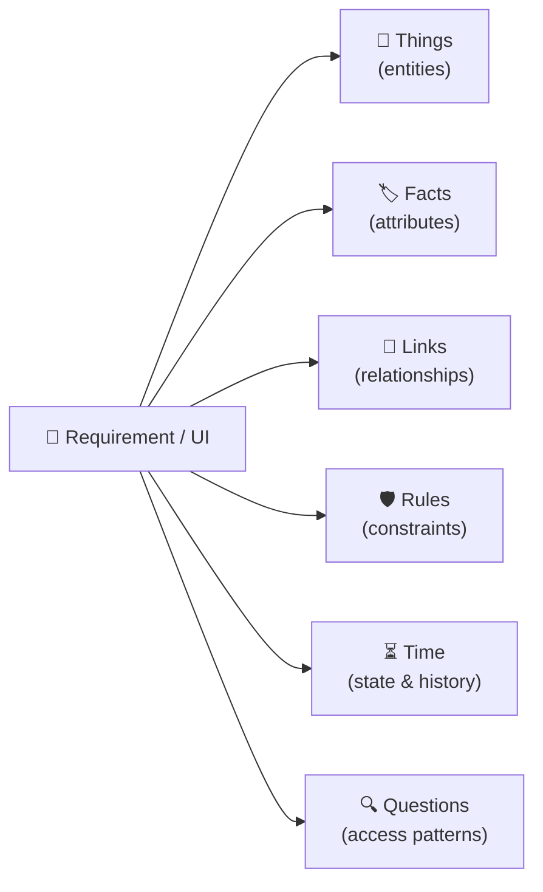
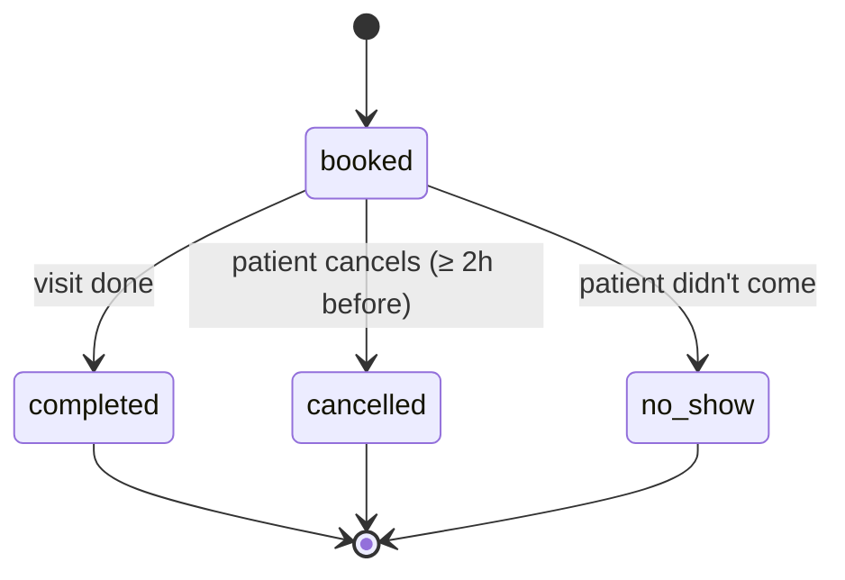
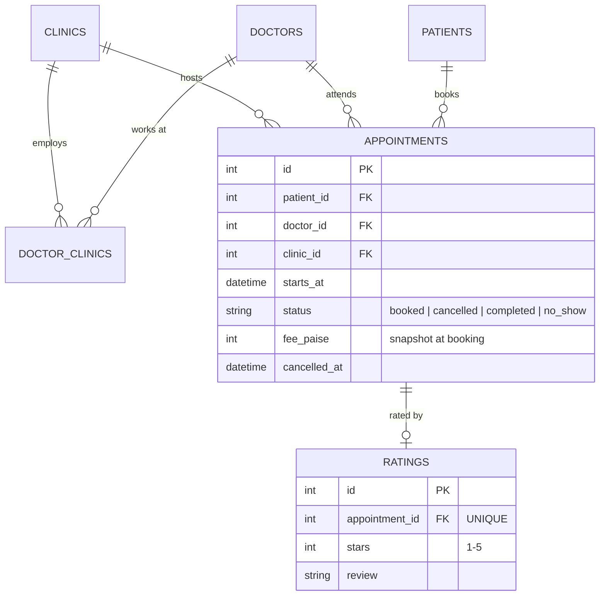
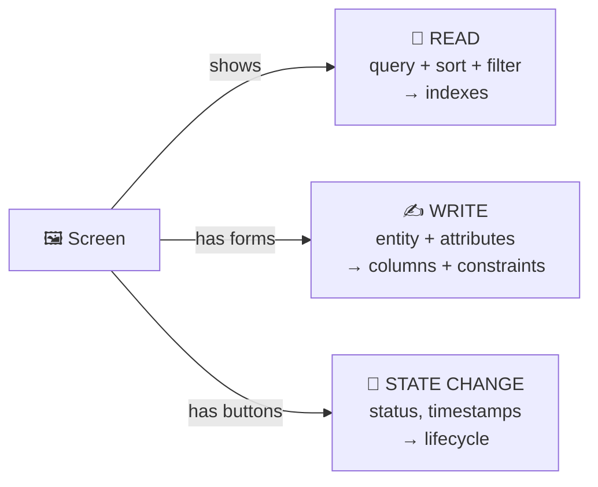
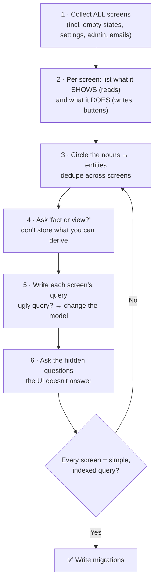
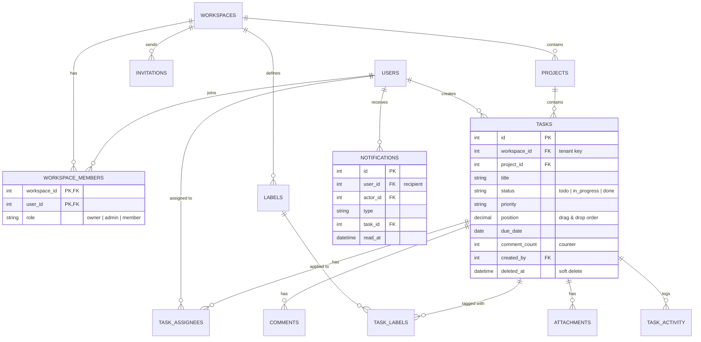

# 🧠 Thinking Like a Data Modeler: From Requirements & UI to Schema

Knowing *what* a data model is ([previous lesson](What-Is-Data-Modeling.md)) is the easy part. The hard part is sitting in front of a vague requirement or a Figma file and answering: **"Which tables do I create, and why?"**

This lesson gives you a **repeatable thought process** that data engineers and senior backend engineers use for *any* business, plus the skill every startup backend engineer needs: **reading a UI and turning it into a data model**.

> 💡 **One-line idea:** the UI is just a *view* of the data. Your job is to find the **truth behind every view**: the things, facts, links, rules and history that all those screens are built from.

---

## 🟢 1. The Mindset Shift: From Features to Facts

A junior developer reads a requirement and thinks in **features and endpoints**. A data modeler reads the same requirement and thinks in **facts**.

| Requirement | Feature thinking ❌ | Fact thinking ✅ |
| :--- | :--- | :--- |
| "Users can like posts" | Add a `POST /like` endpoint | *User X liked post Y at time T.* That's a **row** in a `likes` junction table, unique per (user, post) |
| "Show total likes on the post" | Store a `likes` number | It's **derived** from the likes rows. Store a counter only if reading it is hot |
| "Users can change their plan" | Update `users.plan` | A plan has a **history** (who paid what, when). That's a `subscriptions` table, not a column |

Data modelers look at every requirement through **six lenses**:



---

## 🟢 2. The 9 Questions to Ask About Any Business

Before drawing anything, answer these. Each answer **directly decides** a part of the schema.

| # | Question | What it decides | Example answer (food delivery) |
| :--- | :--- | :--- | :--- |
| 1 | **Who are the actors?** | Users, roles, tenants | Customer, restaurant owner, delivery partner, admin |
| 2 | **What is the core transaction** (how does the business make money)? | The **central entity** everything revolves around | `Order` |
| 3 | **What are the nouns?** | Entities | Restaurant, menu item, cart, order, address, payment |
| 4 | **How many of each per one of the other?** | Cardinality (1:1, 1:N, M:N) | One order has many items; an item appears in many orders → M:N |
| 5 | **What states does it go through?** | `status` column, transitions, timestamps | placed → accepted → picked_up → delivered / cancelled |
| 6 | **What must never be wrong?** | Constraints, transactions | Never charge twice; never deliver a cancelled order |
| 7 | **What will we read most, and how?** | Access patterns → indexes, denormalization | "My last 10 orders", "Live orders for a restaurant" |
| 8 | **What changes over time and needs history?** | Snapshots, audit logs, soft deletes | Menu prices change, but old orders must keep the old price |
| 9 | **How big will it get?** | Pagination, unbounded arrays, partitioning | 1M orders/day → never embed orders inside a user document |

> 🔑 Questions **2** and **7** matter most. The central entity tells you where to start; the access patterns tell you whether your design will survive production.

---

## 🟢 3. From a Written Requirement to a Model (Step by Step)

Let's apply the process to a real requirement.

> *"Patients book appointments with doctors. Each doctor works at one or more clinics and publishes weekly time slots. A patient can cancel up to 2 hours before the appointment. After the visit, the patient can rate the doctor once."*

### Step 1: Underline nouns (entities) and verbs (relationships)

| Nouns → entities | Verbs → relationships |
| :--- | :--- |
| **Patient**, **Doctor**, **Clinic**, **Appointment**, **Time slot**, **Rating** | patient *books* appointment, doctor *works at* clinic, doctor *publishes* slots, patient *rates* doctor |

### Step 2: Ask the cardinality questions out loud

Always ask in **both directions**:

- *Can one doctor work at many clinics?* Yes. *Can one clinic have many doctors?* Yes. → **M:N** (`doctor_clinics`)
- *Can one patient have many appointments?* Yes. *Can one appointment have many patients?* No. → **1:N**
- *Can one appointment have many ratings?* No, "rate **once**". → **1:1** (`UNIQUE(appointment_id)` on `ratings`)

### Step 3: Find the hidden entity

"Appointment" is the **core transaction**. It connects patient + doctor + clinic + time. Most M:N relationships in real business hide an entity like this, and that entity usually has its **own attributes** (status, fee, time).

### Step 4: Model the lifecycle (state)



This becomes `status` + one timestamp per important transition (`cancelled_at`, `completed_at`).

### Step 5: Turn rules into constraints

| Business rule | Where it lives |
| :--- | :--- |
| A slot can't be double-booked | `UNIQUE (doctor_id, starts_at) WHERE status = 'booked'` (partial unique index) |
| Rate only once | `UNIQUE (appointment_id)` on `ratings` |
| Rate only after a completed visit | App check + `rating BETWEEN 1 AND 5` CHECK |
| Cancel only ≥ 2 hours before | App / service layer (depends on *current time*, so not a DB constraint) |

### Step 6: Snapshot what can change

The doctor's fee may change next month, but the bill for a past appointment must not. → Copy `fee` onto the appointment **at booking time**.

### Result



---

## 🟢 4. UI-Driven Data Modeling (The Startup Reality)

In a big company you get a requirements document. In a startup you usually get **a Figma link and a Slack message**: *"Can you have the APIs ready by Friday?"*

So as a startup backend engineer, **the UI *is* your requirements document**. You must read screens the way a data modeler reads a spec.

### The golden rule

> **Every screen is a query. Every form is a write. Every button is a state change.**



### 🧾 Cheat sheet: UI element → data decision

| UI element you see | What it tells you | Data modeling decision |
| :--- | :--- | :--- |
| **Form with fields** | An entity and its attributes | One table (or collection); required `*` fields → `NOT NULL` |
| **Validation hints** ("8–20 chars") | Rules on a value | `CHECK` constraints + backend validation |
| **Dropdown with fixed options** | A closed set of values | `enum` / `CHECK (status IN (...))` |
| **Dropdown whose options admins can edit** | Options are data, not code | A **lookup table** (`categories`, `labels`) |
| **Multi-select / tag chips** | Many on both sides | **M:N junction table** |
| **List, table or feed** | A collection query | Index on *(filter columns, sort column)* + pagination |
| **Infinite scroll** | Cursor pagination | Index on `(created_at, id)` |
| **Tabs** (All / Active / Archived) | A status filter | `status` column, part of the index |
| **Search bar** | Text lookup | Full-text index / trigram / search engine |
| **Filters panel** | Combined `WHERE` clauses | Composite indexes for the combos people actually use |
| **Count / badge** ("💬 12", "🔔 3") | An aggregate | `COUNT(*)` if cheap; a **counter column** if shown on every list item |
| **Avatar + name on a card** | Data from another entity | **Join** (or a denormalized snapshot if it must never change) |
| **"Edited 2h ago", "Last seen"** | Time facts | `updated_at`, `last_seen_at` timestamps (never store the text) |
| **Toggle** (on/off) | A boolean... | `BOOLEAN`, or a **timestamp** (`archived_at`) if *when* matters |
| **Drag-and-drop ordering** | User-defined order | A `position` column (gaps or fractional values) |
| **Price / money** | Exact amounts | Integer **minor units** (`price_paise`) + `currency`, never float |
| **Image / file upload** | A file | Store the object-storage **key/URL**, not the bytes |
| **Activity feed / history** | Who did what, when | Append-only **events** table |
| **Notification bell** | Per-user messages | `notifications` table with `read_at` |
| **Like / ❤️ / bookmark button** | A user ↔ item fact | Junction table with `UNIQUE (user_id, item_id)` |
| **Delete with "Undo" / Trash** | Recoverable delete | Soft delete: `deleted_at` |
| **Buttons only admins see** | Permissions | `role` on the **membership**, not on the user |
| **Workspace / org switcher** | Multi-tenancy | `workspace_id` (tenant key) on every tenant table |
| **Draft / Publish** | Lifecycle | `status` + `published_at` |
| **Address / price on checkout** | Must be frozen at that moment | **Snapshot copy** onto the order |

### 🧭 The 6-step UI → schema process



---

## 🟡 5. Worked Example: "TaskFlow", a Team Task Manager MVP

The designer sends you 4 screens. Let's read them like a data modeler.

### 🖼️ Screen 1: Project board

```text
+--------------------------------------------------------------------+
| [Acme Inc v]   Projects > Website Redesign           (bell 3)  (RS) |
+--------------------------------------------------------------------+
| [Search tasks...]   Filter: [Assignee v] [Label v]       [+ Task]  |
+----------------------+----------------------+----------------------+
| TO DO (4)            | IN PROGRESS (2)      | DONE (9)             |
| +------------------+ | +------------------+ |                      |
| | Fix login bug    | | | New navbar       | |                      |
| | [bug] [urgent]   | | | [design]         | |                      |
| | Due Nov 20       | | | 5 comments       | |                      |
| | (AK)             | | | (AK) (RS)        | |                      |
| +------------------+ | +------------------+ |                      |
+----------------------+----------------------+----------------------+
```

| What I see | What it means | Decision |
| :--- | :--- | :--- |
| `Acme Inc v` switcher | A user belongs to **many** workspaces | `workspaces` + `workspace_members` (M:N), every query scoped by `workspace_id` |
| `Projects > Website Redesign` | Workspace has many projects | `projects.workspace_id` (1:N) |
| Columns TO DO / IN PROGRESS / DONE | Task has a status | **Ask:** can users add/rename columns? MVP: no → `status` enum. Later: `board_columns` table |
| `(4)` in the column header | Count per status | **Derived**: `COUNT(*) GROUP BY status`. Don't store |
| Cards can be dragged | User-defined order | `tasks.position` |
| `[bug] [urgent]` chips | Many labels per task, many tasks per label | `labels` + `task_labels` (M:N) |
| `Due Nov 20` | Optional date | `due_date DATE NULL` |
| `5 comments` on **every** card | Aggregate shown in a list | Counter column `comment_count` (avoid N `COUNT` queries) |
| `(AK) (RS)` avatars | **More than one** assignee | `task_assignees` (M:N), *not* `tasks.assignee_id` |
| `bell 3` | Unread notifications | `notifications.read_at IS NULL` |
| Search + filters | Lookup by title, assignee, label | Text index on title; indexes on junction tables |

### 🖼️ Screen 2: Task detail

```text
+------------------------------------------------------------+
| Fix login bug                            [ In Progress v ]  |
| Created by Riya - 2 days ago       Edited 5 min ago         |
| Assignees: (AK) [+]        Labels: [bug] [urgent] [+]       |
| Due: Nov 20                Priority: [ High v ]             |
|------------------------------------------------------------|
| Description: Users get logged out after refresh...         |
| Attachments: screenshot.png   [Upload]                     |
|------------------------------------------------------------|
| Comments (5)                                               |
| (AK) Aman: Reproduced on Safari                 1h ago     |
| [ Write a comment...                         ] [Send]      |
|------------------------------------------------------------|
| Activity: Riya moved this from To Do -> In Progress  3h ago|
+------------------------------------------------------------+
```

| What I see | Decision |
| :--- | :--- |
| `Created by Riya - 2 days ago` | `created_by` FK → `users`, `created_at`. "2 days ago" is computed by the frontend |
| `Edited 5 min ago` | `updated_at` |
| `Priority: High v` (fixed list, users can't edit) | `CHECK (priority IN ('low','medium','high','urgent'))` |
| Comments with author + time, paginated | `comments (task_id, author_id, body, created_at)` + index `(task_id, created_at)` |
| `[Upload]` | `attachments (task_id, file_key, file_name, mime_type, size_bytes)`, file goes to S3 |
| Activity line | Append-only `task_activity (task_id, actor_id, action, meta, created_at)` |

### 🖼️ Screen 3: Workspace members

```text
Members (3)                                        [Invite member]
(RS) Riya Sharma   riya@acme.com    Owner
(AK) Aman Kumar    aman@acme.com    Admin    [Role v]  [Remove]
     neha@acme.com                  Invited (pending)  [Resend]
```

| What I see | Decision |
| :--- | :--- |
| Owner / Admin roles | `role` on **`workspace_members`**, because Riya can be *Owner* in Acme and *Member* in another workspace |
| `Invited (pending)` with no name | Neha has **no account yet** → separate `invitations` table (remember the *insert anomaly*) |
| `[Remove]` | **Hidden question:** what happens to her tasks and comments? → keep them, delete only the membership row |

### 🖼️ Screen 4: Notifications

```text
Notifications                              [Mark all as read]
* Aman commented on "Fix login bug"                    1h ago
* You were assigned to "New navbar"                    3h ago
  Riya moved "Footer" to Done                       yesterday
```

| What I see | Decision |
| :--- | :--- |
| One row per event, per recipient | `notifications (user_id, actor_id, type, task_id, created_at, read_at)` |
| Bold = unread, `Mark all as read` | `read_at` timestamp; one `UPDATE ... WHERE user_id = ? AND read_at IS NULL` |
| Sentences like "Aman commented on..." | **Don't store the sentence.** Store `type` + references; render text in the app (renames and translations keep working) |

### ❓ The hidden questions the UI does *not* answer

Screens show the happy path. Before writing migrations, ask your PM/designer:

1. Can a task belong to **more than one** project? (No → simple FK.)
2. Will users want **custom columns** per project? (Decides enum vs `board_columns` table.)
3. When a member is removed, do their tasks stay **assigned** to them?
4. Can comments be **edited or deleted**? Do we show "edited"?
5. Do we need **task history** for compliance, or just a nice activity feed?
6. Is "Delete task" permanent or does it go to a **Trash** with restore?
7. Is there an **admin panel / analytics** screen coming soon? (Hidden read patterns!)
8. What's the expected size: tasks per project, members per workspace?

### 📐 Final data model



### 🔍 Prove it: every screen is one simple, indexed query

| Screen | Query (simplified) | Index that makes it fast |
| :--- | :--- | :--- |
| Workspace switcher | `workspace_members WHERE user_id = ?` | `(user_id)` |
| Board | `tasks WHERE project_id = ? AND deleted_at IS NULL ORDER BY status, position` | `(project_id, status, position)` partial |
| Column counts | `COUNT(*) ... GROUP BY status` | same index |
| Assignee filter / "My tasks" | `task_assignees WHERE user_id = ?` | `(user_id)` (PK covers `task_id` first) |
| Task comments | `comments WHERE task_id = ? ORDER BY created_at LIMIT 20` | `(task_id, created_at)` |
| Bell count | `notifications WHERE user_id = ? AND read_at IS NULL` | partial `(user_id) WHERE read_at IS NULL` |
| Members page | `workspace_members WHERE workspace_id = ?` | PK `(workspace_id, user_id)` |

If any screen needed a 6-table join or a full scan, that's your signal to **go back and change the model**, not to "optimize later".

### 🗄️ Physical schema (PostgreSQL)

```sql
CREATE TABLE users (
  id          BIGSERIAL PRIMARY KEY,
  email       TEXT NOT NULL UNIQUE,
  name        TEXT NOT NULL,
  avatar_url  TEXT,
  created_at  TIMESTAMPTZ NOT NULL DEFAULT now()
);

CREATE TABLE workspaces (
  id          BIGSERIAL PRIMARY KEY,
  name        TEXT NOT NULL,
  created_at  TIMESTAMPTZ NOT NULL DEFAULT now()
);

-- Role lives on the membership: the same user can have different roles in different workspaces.
CREATE TABLE workspace_members (
  workspace_id BIGINT NOT NULL REFERENCES workspaces(id) ON DELETE CASCADE,
  user_id      BIGINT NOT NULL REFERENCES users(id),
  role         TEXT   NOT NULL CHECK (role IN ('owner', 'admin', 'member')),
  joined_at    TIMESTAMPTZ NOT NULL DEFAULT now(),
  PRIMARY KEY (workspace_id, user_id)
);
CREATE INDEX ON workspace_members (user_id);

-- Invites exist before the invited person has an account.
CREATE TABLE invitations (
  id           BIGSERIAL PRIMARY KEY,
  workspace_id BIGINT NOT NULL REFERENCES workspaces(id) ON DELETE CASCADE,
  email        TEXT   NOT NULL,
  role         TEXT   NOT NULL CHECK (role IN ('admin', 'member')),
  token        TEXT   NOT NULL UNIQUE,
  invited_by   BIGINT NOT NULL REFERENCES users(id),
  expires_at   TIMESTAMPTZ NOT NULL,
  accepted_at  TIMESTAMPTZ
);
CREATE UNIQUE INDEX ON invitations (workspace_id, email) WHERE accepted_at IS NULL;

CREATE TABLE projects (
  id           BIGSERIAL PRIMARY KEY,
  workspace_id BIGINT NOT NULL REFERENCES workspaces(id) ON DELETE CASCADE,
  name         TEXT   NOT NULL,
  created_at   TIMESTAMPTZ NOT NULL DEFAULT now()
);
CREATE INDEX ON projects (workspace_id);

CREATE TABLE tasks (
  id            BIGSERIAL PRIMARY KEY,
  workspace_id  BIGINT  NOT NULL REFERENCES workspaces(id), -- tenant key: every query is scoped by it
  project_id    BIGINT  NOT NULL REFERENCES projects(id) ON DELETE CASCADE,
  title         TEXT    NOT NULL CHECK (length(title) BETWEEN 1 AND 200),
  description   TEXT,
  status        TEXT    NOT NULL DEFAULT 'todo'
                CHECK (status IN ('todo', 'in_progress', 'done')),
  priority      TEXT    NOT NULL DEFAULT 'medium'
                CHECK (priority IN ('low', 'medium', 'high', 'urgent')),
  position      NUMERIC NOT NULL,           -- drag & drop order inside a column
  due_date      DATE,
  comment_count INT     NOT NULL DEFAULT 0, -- shown on every card; updated in the same transaction as the comment
  created_by    BIGINT  NOT NULL REFERENCES users(id),
  created_at    TIMESTAMPTZ NOT NULL DEFAULT now(),
  updated_at    TIMESTAMPTZ NOT NULL DEFAULT now(),
  deleted_at    TIMESTAMPTZ                 -- Trash + restore
);
CREATE INDEX ON tasks (project_id, status, position) WHERE deleted_at IS NULL;

CREATE TABLE task_assignees (
  task_id BIGINT NOT NULL REFERENCES tasks(id) ON DELETE CASCADE,
  user_id BIGINT NOT NULL REFERENCES users(id),
  PRIMARY KEY (task_id, user_id)
);
CREATE INDEX ON task_assignees (user_id);

CREATE TABLE labels (
  id           BIGSERIAL PRIMARY KEY,
  workspace_id BIGINT NOT NULL REFERENCES workspaces(id) ON DELETE CASCADE,
  name         TEXT   NOT NULL,
  color        TEXT   NOT NULL,
  UNIQUE (workspace_id, name)
);

CREATE TABLE task_labels (
  task_id  BIGINT NOT NULL REFERENCES tasks(id) ON DELETE CASCADE,
  label_id BIGINT NOT NULL REFERENCES labels(id) ON DELETE CASCADE,
  PRIMARY KEY (task_id, label_id)
);
CREATE INDEX ON task_labels (label_id);

CREATE TABLE comments (
  id         BIGSERIAL PRIMARY KEY,
  task_id    BIGINT NOT NULL REFERENCES tasks(id) ON DELETE CASCADE,
  author_id  BIGINT NOT NULL REFERENCES users(id),
  body       TEXT   NOT NULL,
  created_at TIMESTAMPTZ NOT NULL DEFAULT now(),
  edited_at  TIMESTAMPTZ,
  deleted_at TIMESTAMPTZ
);
CREATE INDEX ON comments (task_id, created_at);

CREATE TABLE attachments (
  id          BIGSERIAL PRIMARY KEY,
  task_id     BIGINT NOT NULL REFERENCES tasks(id) ON DELETE CASCADE,
  uploaded_by BIGINT NOT NULL REFERENCES users(id),
  file_key    TEXT   NOT NULL,              -- object-storage key, not the file bytes
  file_name   TEXT   NOT NULL,
  mime_type   TEXT   NOT NULL,
  size_bytes  BIGINT NOT NULL CHECK (size_bytes > 0),
  created_at  TIMESTAMPTZ NOT NULL DEFAULT now()
);

-- Append-only: never UPDATE, never DELETE.
CREATE TABLE task_activity (
  id         BIGSERIAL PRIMARY KEY,
  task_id    BIGINT NOT NULL REFERENCES tasks(id) ON DELETE CASCADE,
  actor_id   BIGINT NOT NULL REFERENCES users(id),
  action     TEXT   NOT NULL,               -- 'status_changed', 'assigned', ...
  meta       JSONB  NOT NULL DEFAULT '{}',  -- e.g. {"from": "todo", "to": "in_progress"}
  created_at TIMESTAMPTZ NOT NULL DEFAULT now()
);
CREATE INDEX ON task_activity (task_id, created_at);

CREATE TABLE notifications (
  id         BIGSERIAL PRIMARY KEY,
  user_id    BIGINT NOT NULL REFERENCES users(id),  -- recipient
  actor_id   BIGINT REFERENCES users(id),
  type       TEXT   NOT NULL,                       -- 'comment', 'assigned', 'moved'
  task_id    BIGINT REFERENCES tasks(id) ON DELETE CASCADE,
  created_at TIMESTAMPTZ NOT NULL DEFAULT now(),
  read_at    TIMESTAMPTZ
);
CREATE INDEX ON notifications (user_id, created_at DESC);
CREATE INDEX ON notifications (user_id) WHERE read_at IS NULL;
```

### 🍃 Same screens, MongoDB version

In MongoDB you design around the **same screens**, but you decide *embed vs reference* per piece of data ([Embedding vs Referencing](../MongoDB-Schema-Design-Patterns/Embedding-vs-Referencing.md)):

| Data | Embed or reference? | Why (from the UI) |
| :--- | :--- | :--- |
| Label ids, assignee ids on a task | **Embed** (small arrays) | Shown on every card; bounded (a task has a few labels) |
| Comments | **Reference** (`comments` collection) | Unbounded, paginated on the detail screen |
| Activity log | **Reference** | Grows forever |
| Comment count | **Embed** counter on the task | Shown on every card |
| Members | **Reference** (`memberships` collection) | M:N with a role per side |

---

## 🔴 6. Traps of UI-Driven Modeling

The UI is a great *source* of requirements, but a bad *shape* for your schema.

| Trap ❌ | Why it hurts | Do this instead ✅ |
| :--- | :--- | :--- |
| One table per screen (`dashboard_data`) | Screens change every sprint; data stays for years | Model the **business things**; screens are queries over them |
| Storing display values ("2 days ago", "₹1,500.00", "Riya S.") | Goes stale, breaks i18n and sorting | Store raw facts: timestamps, integer paise, user ids |
| "The design shows one avatar, so one assignee" | The next design shows three → painful migration | Ask *"will it ever be more than one?"* M:N is cheap now, expensive later |
| Modeling only the designed screens | Admin panel, analytics, emails and exports are screens too | Ask for the roadmap; list the hidden read patterns |
| Hard-coding what users will want to customize | Columns, categories, roles become data later | Lookup table when users/admins can change the options |
| Hard delete when the UI has Undo/Trash | Data is gone, Undo is impossible | `deleted_at` soft delete |
| Referencing a value that must be frozen | Old invoices change when the price changes | **Snapshot** (copy) price/address onto the order |
| Snapshotting a value that should stay live | Author renames, old comments show old name | **Reference** (`author_id`) and join |
| Forgetting `tenant_id` | Data leaks between customers | Tenant key on every tenant-owned table, in every query |

> 🔑 **Copy or reference?** Ask: *"If the original changes tomorrow, should this record change too?"* Yes → reference. No → snapshot.

---

## 🧭 7. A Reusable Template: Feature Data Spec

Fill this in (in your PR description or design doc) **before** writing a migration. It takes 15 minutes and saves weeks.

```markdown
## Feature: <name>

### Screens & actions
- Screen: <name> → shows: <data> | actions: <buttons/forms>

### Entities (new / changed)
- <entity>: <key attributes>, <required?>, <unique?>

### Relationships
- <A> 1:N <B> because <reason from UI or business>

### Lifecycle
- <entity>.status: <state> → <state> (who can trigger it?)

### Rules (constraints)
- <rule> → <UNIQUE / CHECK / FK / app check>

### Access patterns (one per screen)
- <screen>: <query> → index <(columns)>

### Snapshot vs reference
- <field>: snapshot / reference, because <reason>

### Open questions for PM / design
- <question>
```

---

## 🏋️ 8. Practice: Model This Screen Yourself

A food delivery startup sends you this **restaurant page**. Try the 6-step process before reading the solution.

```text
+------------------------------------------------------------+
| Spice Hub    4.3 (1.2k ratings)   30-35 min   Rs 300 for two|
| North Indian, Chinese                          [Open now]   |
|------------------------------------------------------------|
| [x] Veg only     Recommended | Starters | Main Course       |
|------------------------------------------------------------|
| (veg) Paneer Tikka                 Rs 249      [ ADD + ]    |
|       Bestseller                   Customisable             |
|       Size: Half / Full     Extras: Cheese (+Rs 30)         |
|------------------------------------------------------------|
| Cart: 2 items | Rs 528                        [Checkout ->] |
+------------------------------------------------------------+
```

### ✅ Solution sketch

| UI element | Decision |
| :--- | :--- |
| `North Indian, Chinese` | `cuisines` + `restaurant_cuisines` (M:N) |
| `4.3 (1.2k ratings)` | `reviews` table + **counters** `rating_avg`, `rating_count` on the restaurant (shown on every listing card) |
| `Rs 300 for two` | `cost_for_two_paise INT` |
| `[Open now]` | **Derived** from an `opening_hours (restaurant_id, weekday, opens_at, closes_at)` table, don't store `is_open` |
| `Recommended / Starters / Main Course` tabs | `menu_categories (restaurant_id, name, position)` |
| `(veg)`, `[x] Veg only` filter | `menu_items.is_veg BOOLEAN` + index `(restaurant_id, is_veg)` |
| `Bestseller` badge | Derived from order stats, or a `tags` M:N if marketing sets it by hand (ask!) |
| `Size: Half / Full` | `item_variants (item_id, name, price_paise)`: price depends on the variant |
| `Extras: Cheese (+Rs 30)` | `addon_groups (item_id, min_select, max_select)` + `addons (group_id, name, price_paise)` |
| `Cart: 2 items` | `carts (user_id, restaurant_id)` + `cart_items (variant_id, quantity)` + `cart_item_addons` |
| `[Checkout ->]` | Creates an `order` + `order_items` that **snapshot** item name, variant, add-ons and prices |

---

## 🗺️ Where to Go Next

1.  **[One-to-One Relationships](../relationship/one_to_one/one-to-one.md)**: master the building blocks you used above.
2.  **[ER Diagrams](../ER-Diagrams/README.md)**: draw your models so the whole team can review them.
3.  **[Database Indexing](../Database-Indexing/Single-and-Compound-Indexes.md)**: turn your access-pattern list into the right indexes.

---

## 💡 Senior Engineer Tip:
"When you get a new Figma file, don't open your editor. Open a blank page and write **one query per screen**. If you can't write a simple query for a screen, your model isn't ready, and the cheapest time to fix it is now, before the first migration."
