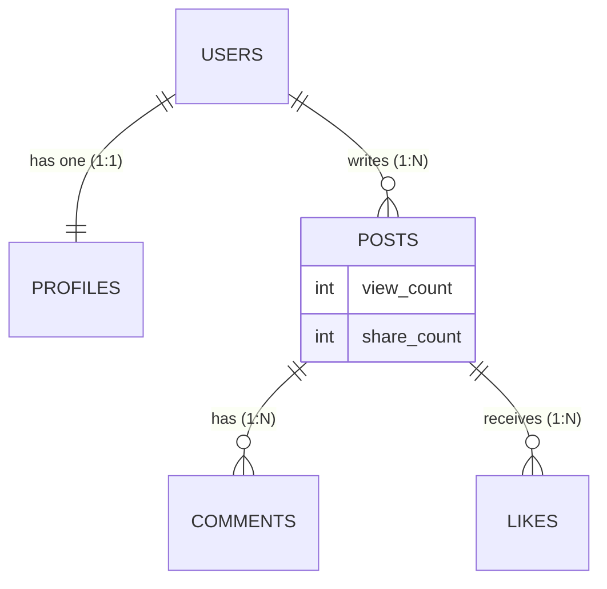
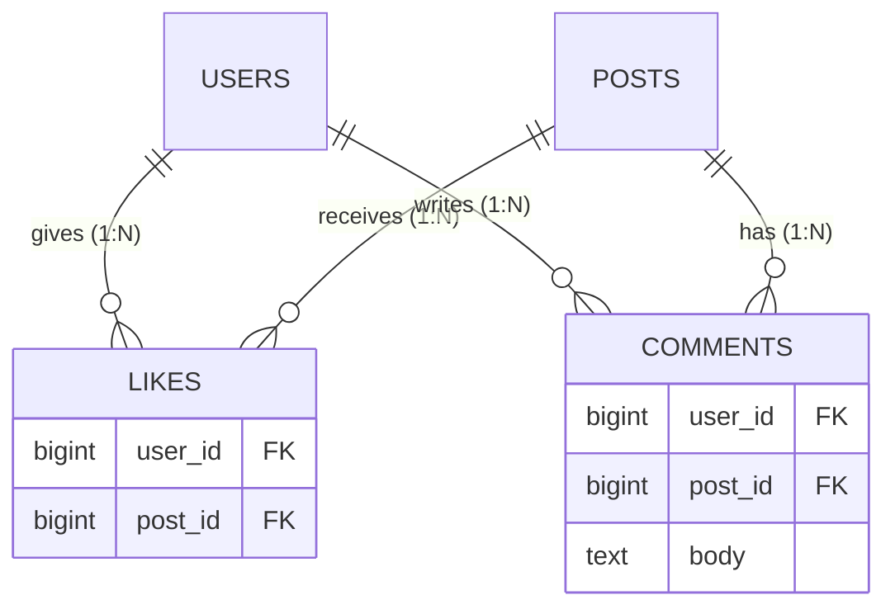
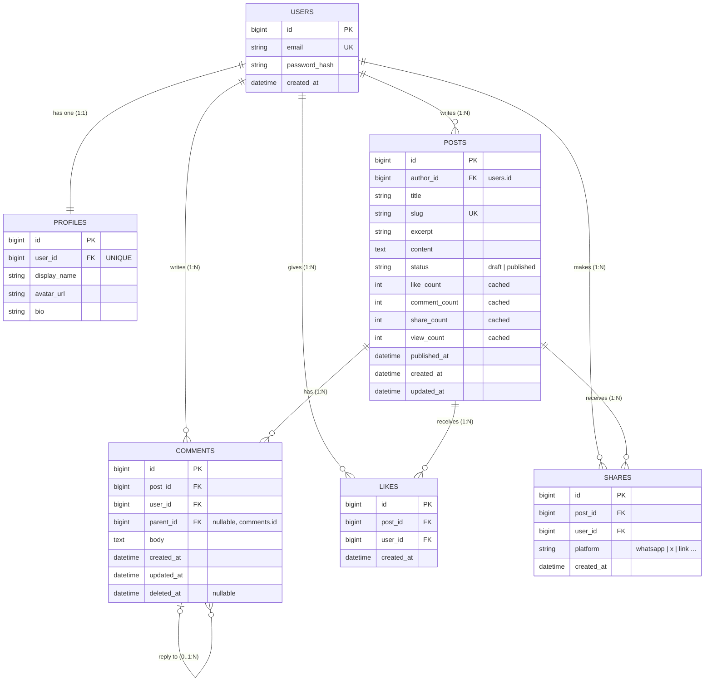
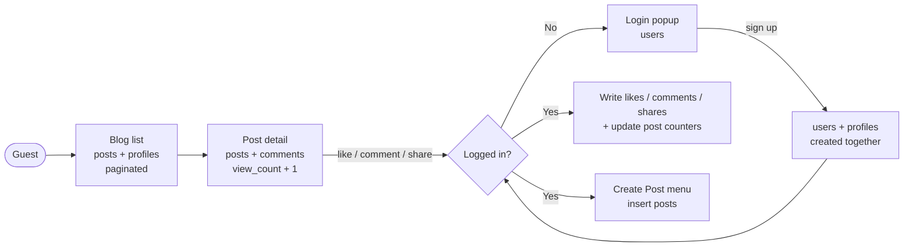

# 📝 Blog Application: Data Model

A practice project: turn a business requirement into tables, relationships and a complete ER diagram.

## 1. Business requirement

- Anyone can open the blog and see a **paginated list of posts**.
- Clicking a post opens its **detail page**.
- Every post shows its **author**, and its number of **likes, comments, views and shares**.
- A guest who tries to like, comment or share sees a **login popup**. They can log in or create an account.
- A logged-in user gets an extra **Create Post** menu, and can **like, comment and share**.

## 2. Your first draft

| Entity | Relationship you identified |
| --- | --- |
| user → profile | one-to-one ✅ |
| user → post | one-to-many ✅ |
| post → comment | one-to-many ✅ |
| post → user | same as user → post, seen from the other side (many-to-one) |
| post → like | one-to-many ✅ |

Views and shares were planned as columns inside `posts`.

Your draft in ER notation. Notice `COMMENTS` and `LIKES` only touch `POSTS`, so nothing says **who** commented or liked:



## 3. What is missing

### 3.1 Comments and likes need a user too

You linked `comment` and `like` to the post, but not to **who** did it.
A comment has an author, and a like belongs to one user. Both need `user_id`.

That makes `likes` and `comments` **junction tables** between `users` and `posts`:



Two one-to-many lines meeting in one table is how ER notation draws a **many-to-many**.
So **user ↔ post is many-to-many twice**: once through likes, once through comments.

### 3.2 One like per user per post

Without a rule a user can like the same post 100 times.
Add `UNIQUE (user_id, post_id)` on `likes`. Unlike = delete the row.

### 3.3 Shares need their own table

The requirement says sharing needs login, so every share has a known user.
A plain `share_count` column cannot tell you **who** shared or **where** (WhatsApp, X, link copy).
Keep a `shares` table, and keep `share_count` on `posts` only as a fast counter.

### 3.4 Views can stay a counter

Guests view posts, so there is often no user to record. A `view_count` column on `posts` is fine.
Add a `post_views` table later only if you need unique views or analytics.

### 3.5 Counters on posts (denormalization)

The list page shows likes, comments, views and shares for **every post on every page**.
Counting rows each time (`COUNT(*)` over likes for 20 posts) is slow at scale, so store:

`like_count`, `comment_count`, `share_count`, `view_count` on `posts`

and update them in the **same transaction** as the insert/delete in `likes`, `comments` or `shares`.

### 3.6 Columns the screens need

| Need | Column |
| --- | --- |
| Pretty detail URL `/blog/my-first-post` | `posts.slug` UNIQUE |
| Drafts are not shown in the list | `posts.status` (`draft` / `published`) |
| List sorted newest first, paginated | `posts.published_at` + index `(status, published_at DESC, id)` |
| Card preview text | `posts.excerpt` |
| Login / signup | `users.email` UNIQUE, `users.password_hash` |
| Author name and photo on each post | `profiles.display_name`, `profiles.avatar_url` |
| Edited / deleted comments | `comments.updated_at`, `comments.deleted_at` |

### 3.7 Optional, add when the product asks

- **Replies to comments**: `comments.parent_id` → `comments.id` (self-reference).
- **Tags / categories**: `tags` + `post_tags` (many-to-many).
- **Bookmarks**: same shape as `likes`.

## 4. Complete ER diagram



> `LIKES` has `UNIQUE (user_id, post_id)`. `PROFILES.user_id` is `UNIQUE`, which is what makes user ↔ profile one-to-one.

### How to read this diagram

Every line is read as a sentence: **LEFT table + label + RIGHT table**, and the symbols at each end say **how many**.

`USERS ||--o{ POSTS : "writes"` → "One user **writes** zero or many posts."

### Relationship labels (the words on the lines)

A label is only a **human-readable verb** for the relationship. It does not create anything in the database. The **foreign key** does the real work. Pick a verb that makes the sentence true from the left table's point of view.

| Label | Line in the diagram | Read it as | Foreign key that makes it real |
| --- | --- | --- | --- |
| **has one** | `USERS \|\|--\|\| PROFILES` | A user has exactly one profile. | `profiles.user_id` (UNIQUE) |
| **writes** | `USERS \|\|--o{ POSTS` | A user writes zero or many posts. | `posts.author_id` |
| **writes** | `USERS \|\|--o{ COMMENTS` | A user writes zero or many comments. | `comments.user_id` |
| **gives** | `USERS \|\|--o{ LIKES` | A user gives zero or many likes. | `likes.user_id` |
| **makes** | `USERS \|\|--o{ SHARES` | A user makes zero or many shares. | `shares.user_id` |
| **has** | `POSTS \|\|--o{ COMMENTS` | A post has zero or many comments. | `comments.post_id` |
| **receives** | `POSTS \|\|--o{ LIKES` / `SHARES` | A post receives zero or many likes / shares. | `likes.post_id`, `shares.post_id` |
| **reply to** | `COMMENTS \|o--o{ COMMENTS` | A comment can be a reply to one parent comment, and can have many replies. | `comments.parent_id` (nullable) |

The same label can repeat (`writes` twice). Read it from the other side too: "a post is **written by** exactly one user".

### Data modeling keywords

| Term | Meaning | In this project |
| --- | --- | --- |
| **Entity** | A thing you store data about. Becomes a table (or collection). | `users`, `posts`, `likes` |
| **Attribute** | A property of an entity. Becomes a column (or field). | `posts.title` |
| **PK** (primary key) | Column that uniquely identifies each row. | `id` in every table |
| **FK** (foreign key) | Column that points to another table's PK. This is what creates a relationship. | `posts.author_id` → `users.id` |
| **UK** (unique key) | No two rows may have the same value. | `users.email`, `posts.slug` |
| **Cardinality** | The **maximum** on each side: one or many. | one user → many posts |
| **Optionality** (modality) | The **minimum** on each side: zero (optional) or one (required). | A user may have **zero** posts. |
| **One-to-one** (1:1) | One row on each side, at most. | user ↔ profile |
| **One-to-many** (1:N) | One row on the left, many on the right. FK sits on the "many" side. | post → comments |
| **Many-to-one** (N:1) | The same as 1:N, read from the other side. | comments → post |
| **Many-to-many** (M:N) | Many on both sides. Always needs a junction table in SQL. | users ↔ posts (through likes) |
| **Junction table** (join / bridge / associative table) | A table whose rows link two other tables. Can carry its own data. | `likes`, `comments`, `shares` |
| **Composite unique key** | Uniqueness over a combination of columns. | `UNIQUE (user_id, post_id)` on `likes` |
| **Self-referencing relationship** | A table with an FK to itself. | `comments.parent_id` → `comments.id` |
| **Identifying vs non-identifying** | Solid line (`--`) means the child's identity depends on the parent. Dashed line (`..`) means it does not. | All lines here are solid. |
| **Nullable** | The column may be empty, which makes that side optional. | `comments.parent_id`, `deleted_at` |
| **Denormalization** / **cached counter** | Storing a derived value (like a count) to make reads fast, at the cost of keeping it in sync. | `posts.like_count` |
| **Soft delete** | Mark a row as deleted (`deleted_at`) instead of removing it. | `comments.deleted_at` |
| **Keyset pagination** | Page using "rows after the last one I saw" instead of `OFFSET`. Stays fast on big tables. | list page query in section 7 |

## 5. Final relationships

| From | To | Type | Where the FK lives |
| --- | --- | --- | --- |
| users | profiles | one-to-one | `profiles.user_id` (UNIQUE) |
| users | posts | one-to-many | `posts.author_id` |
| posts | comments | one-to-many | `comments.post_id` |
| users | comments | one-to-many | `comments.user_id` |
| posts | likes | one-to-many | `likes.post_id` |
| users | likes | one-to-many | `likes.user_id` |
| posts | shares | one-to-many | `shares.post_id` |
| users | shares | one-to-many | `shares.user_id` |
| users ↔ posts | | many-to-many | through `likes`, `comments`, `shares` |
| comments | comments | one-to-many (optional) | `comments.parent_id` |

## 6. Screen → table map



## 7. Queries the screens run

```sql
-- List page: newest published posts with author (keyset pagination)
SELECT p.id, p.title, p.slug, p.excerpt, p.like_count, p.comment_count,
       p.share_count, p.view_count, p.published_at,
       pr.display_name, pr.avatar_url
FROM posts p
JOIN profiles pr ON pr.user_id = p.author_id
WHERE p.status = 'published'
  AND (p.published_at, p.id) < (:last_published_at, :last_id)
ORDER BY p.published_at DESC, p.id DESC
LIMIT 20;

-- Like a post (one transaction)
INSERT INTO likes (post_id, user_id) VALUES (:post_id, :user_id);
UPDATE posts SET like_count = like_count + 1 WHERE id = :post_id;
```
