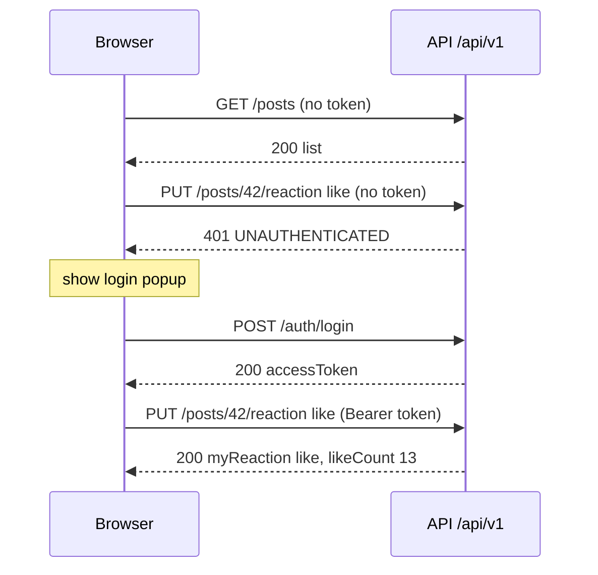

# 🔌 Blog Application: API Design

The REST API on top of the [data model](README.md). Every endpoint below maps to the tables designed there.

## Download the spec

The full contract is an OpenAPI 3.1 file you can import into Postman, Insomnia or Swagger Editor:

- [⬇️ Download openapi.yaml (raw)](https://raw.githubusercontent.com/Ashukr321/Complete-Database-Modeling-Basic-to-Advanced/main/projects/blog-application/openapi.yaml): right-click → **Save link as…**
- [View openapi.yaml on GitHub](openapi.yaml): has a download button at the top right

> **Postman:** Import → Link → paste the raw URL above. **Swagger Editor:** File → Import URL.

## 1. Versioning

| Rule | Value |
| --- | --- |
| Base URL | `https://api.example.com/api/v1` |
| Where the version lives | In the URL path: `/api/v1/...` |
| Spec version | `info.version: 1.0.0` in `openapi.yaml` (semver) |
| Non-breaking change (new endpoint, new optional field) | Stays in `v1`, bump minor: `1.1.0` |
| Breaking change (removed/renamed field, new required field, changed meaning) | New `/api/v2`, `v1` keeps running |
| Retiring `v1` | Responses get `Deprecation: true` and `Sunset: <date>` headers for at least 6 months first |

Why the URL and not a header? It is visible in logs, cacheable, and easy to try in a browser.

## 2. Conventions

| Topic | Rule |
| --- | --- |
| Format | JSON, `camelCase` fields, ISO-8601 UTC dates |
| Auth | `Authorization: Bearer <accessToken>` (JWT from register / login) |
| IDs | Numbers in the DB, sent as strings (`"42"`) so big ints stay safe in JavaScript |
| Pagination | Keyset: `?limit=20&cursor=<nextCursor>`. Response has `meta.nextCursor` (`null` on the last page) |
| Partial update | `PATCH` sends only the fields that change |
| Success codes | `200` read/update, `201` created, `204` deleted (no body) |

### Error shape (every 4xx / 5xx)

```json
{
  "error": {
    "code": "VALIDATION_ERROR",
    "message": "title is required",
    "details": [{ "field": "title", "issue": "required" }]
  }
}
```

| Status | `code` | When |
| --- | --- | --- |
| 400 | `VALIDATION_ERROR` | Body or query fails validation |
| 401 | `UNAUTHENTICATED` | No token, bad token, expired token. The frontend shows the **login popup** on this |
| 403 | `FORBIDDEN` | Logged in, but not the creator of the post / comment |
| 404 | `NOT_FOUND` | Post or comment does not exist (or is a draft you do not own) |
| 409 | `CONFLICT` | Email or slug already taken |
| 429 | `RATE_LIMITED` | Too many requests (login, comments) |

## 3. Endpoint map

🔓 = public, 🔒 = needs login, 👤 = creator only

| # | Method | Path | Access | Purpose | Tables touched |
| --- | --- | --- | --- | --- | --- |
| **Auth** | | | | | |
| 1 | POST | `/auth/register` | 🔓 | Create account | `users` + `profiles` (one transaction) |
| 2 | POST | `/auth/login` | 🔓 | Get a token | `users` |
| **Profiles** | | | | | |
| 3 | GET | `/me/profile` | 🔒 | My profile (with email) | `users` ⨝ `profiles` |
| 4 | PATCH | `/me/profile` | 🔒 | Edit my name, avatar, bio | `profiles` |
| 5 | GET | `/profiles/{userId}` | 🔓 | Anyone's public profile | `users` ⨝ `profiles` |
| 6 | GET | `/profiles/{userId}/posts` | 🔓 | That author's published posts | `posts` ⨝ `profiles` |
| **Posts** | | | | | |
| 7 | GET | `/posts` | 🔓 | Paginated list of published posts | `posts` ⨝ `profiles` |
| 8 | GET | `/posts/by-slug/{slug}` | 🔓 | Post detail, counts `view_count + 1` | `posts` ⨝ `profiles` |
| 9 | POST | `/posts` | 🔒 | Create post | `posts` |
| 10 | PATCH | `/posts/{postId}` | 🔒👤 | Update own post | `posts` |
| 11 | DELETE | `/posts/{postId}` | 🔒👤 | Delete own post | `posts` (cascade reactions, comments, shares) |
| **Reactions** | | | | | |
| 12 | PUT | `/posts/{postId}/reaction` | 🔒 | Like or dislike (or switch) | `reactions` + `posts.like_count` / `dislike_count` |
| 13 | DELETE | `/posts/{postId}/reaction` | 🔒 | Remove my like / dislike | `reactions` + `posts.like_count` / `dislike_count` |
| **Comments** | | | | | |
| 14 | GET | `/posts/{postId}/comments` | 🔓 | Paginated comments | `comments` ⨝ `profiles` |
| 15 | POST | `/posts/{postId}/comments` | 🔒 | Add comment / reply | `comments` + `posts.comment_count` |
| 16 | PATCH | `/comments/{commentId}` | 🔒👤 | Edit own comment | `comments` |
| 17 | DELETE | `/comments/{commentId}` | 🔒👤 | Delete own comment (soft) | `comments.deleted_at` + `posts.comment_count` |
| **Shares** | | | | | |
| 18 | POST | `/posts/{postId}/shares` | 🔒 | Record a share | `shares` + `posts.share_count` |

All paths are under `/api/v1`.

> **Why `by-slug` for the detail page but `{postId}` everywhere else?** The page URL `/blog/my-first-post` only knows the slug. IDs never change, so writes stay correct even if a title (and slug) is edited. `/posts/{slug}` cannot sit next to `/posts/{postId}`: the server could not tell them apart.

## 4. Auth

### 4.1 Register: `POST /api/v1/auth/register` 🔓

```json
// request
{ "email": "asha@example.com", "password": "S3cure!pass", "displayName": "Asha" }

// 201 Created
{
  "data": {
    "user": { "id": "1", "email": "asha@example.com", "displayName": "Asha", "avatarUrl": null },
    "accessToken": "eyJhbGciOi...",
    "expiresIn": 3600
  }
}
```

- `password` min 8 chars; stored as `password_hash` (bcrypt/argon2), never returned.
- `users` and `profiles` rows are inserted **in one transaction** (the 1:1 rule).
- `409 CONFLICT` if the email exists.

### 4.2 Login: `POST /api/v1/auth/login` 🔓

```json
// request
{ "email": "asha@example.com", "password": "S3cure!pass" }

// 200 OK: same body as register
```

- Wrong email **or** password → the same `401` message, so attackers cannot tell which emails exist.

## 5. Profiles

Auth is about **who you are** (`users`: email, password). Profile is about **how you look to others** (`profiles`: name, avatar, bio). They are separate tables (1:1), so they get separate endpoints: editing your bio never touches login data.

### 5.1 My profile: `GET /api/v1/me/profile` 🔒

```json
// 200 OK
{
  "data": {
    "userId": "1",
    "email": "asha@example.com",
    "displayName": "Asha",
    "avatarUrl": null,
    "bio": "Writes about databases",
    "joinedAt": "2026-11-01T08:00:00Z"
  }
}
```

### 5.2 Edit my profile: `PATCH /api/v1/me/profile` 🔒

```json
// request: any subset
{ "displayName": "Asha K", "avatarUrl": "https://cdn.example.com/a.png", "bio": "Writes about databases" }
```

`200` with the updated profile. `displayName` 1–80 chars, `bio` up to 300, `avatarUrl` an `https` URL or `null`.
Email and password are **not** editable here; they belong to auth (future `/auth/...` endpoints).

> **Why `/me/profile` and not `PATCH /profiles/{userId}`?** The user comes from the token, so there is no ID in the URL to tamper with and no "is this your profile?" check to forget.

### 5.3 Public profile: `GET /api/v1/profiles/{userId}` 🔓

Same as 5.1 **without `email`** (never expose emails publicly). `404` if the user does not exist.

### 5.4 Author's posts: `GET /api/v1/profiles/{userId}/posts?limit=20&cursor=...` 🔓

Same response shape as `GET /posts`, filtered to `author_id = userId` and `status = 'published'`.

## 6. Posts

### 6.1 List posts: `GET /api/v1/posts?limit=20&cursor=...` 🔓

Only `status = 'published'`, newest first. Uses the keyset query from the data model.

```json
// 200 OK
{
  "data": [
    {
      "id": "42",
      "title": "My first post",
      "slug": "my-first-post",
      "excerpt": "Short preview text...",
      "author": { "id": "1", "displayName": "Asha", "avatarUrl": null },
      "counts": { "likes": 12, "dislikes": 2, "comments": 3, "shares": 1, "views": 240 },
      "myReaction": null,
      "publishedAt": "2026-11-20T10:00:00Z"
    }
  ],
  "meta": { "limit": 20, "nextCursor": "MjAyNi0xMS0yMFQxMDowMDowMFp8NDI" }
}
```

- `limit`: 1–50, default 20.
- `cursor` is an opaque base64 of `(published_at, id)` of the last row. The client never builds it.
- `myReaction` is `"like"`, `"dislike"` or `null`. Always `null` for guests; filled when a token is sent (so the right button is highlighted).

### 6.2 Post detail: `GET /api/v1/posts/by-slug/{slug}` 🔓

Same fields as a list item plus `content`, `status`, `createdAt`, `updatedAt`. Increments `view_count`.
A draft returns `404` to everyone except its author.

### 6.3 Create post: `POST /api/v1/posts` 🔒

```json
// request
{ "title": "My first post", "content": "Full body...", "excerpt": "Short preview", "status": "published" }

// 201 Created: the post object; Location: /api/v1/posts/by-slug/my-first-post
```

- `author_id` comes from the token, **never** from the body.
- `slug` is generated from the title; a number is appended if taken (`my-first-post-2`).
- `status` defaults to `draft`. `published_at` is set the first time it becomes `published`.

### 6.4 Update post: `PATCH /api/v1/posts/{postId}` 🔒👤

```json
// request: any subset
{ "title": "New title", "status": "published" }
```

`200` with the updated post. `403` if `posts.author_id ≠ token user`.

### 6.5 Delete post: `DELETE /api/v1/posts/{postId}` 🔒👤

`204 No Content`. `403` if not the creator. Its reactions, comments and shares go with it (`ON DELETE CASCADE`).

## 7. Reactions (like / dislike)

One `reactions` table with a `type` column, not separate `likes` and `dislikes` tables (why: [data model §3.8](README.md#38-dislike-one-reactions-table-not-a-second-dislikes-table)). So the API has **one** resource: *my reaction on this post*.

### 7.1 Like, dislike or switch: `PUT /api/v1/posts/{postId}/reaction` 🔒

```json
// request
{ "type": "dislike" }

// 200 OK
{ "data": { "myReaction": "dislike", "likeCount": 12, "dislikeCount": 3 } }
```

### 7.2 Remove my reaction: `DELETE /api/v1/posts/{postId}/reaction` 🔒

```json
// 200 OK
{ "data": { "myReaction": null, "likeCount": 12, "dislikeCount": 2 } }
```

| Button tapped | Current `myReaction` | Call |
| --- | --- | --- |
| 👍 | `null` or `dislike` | `PUT { "type": "like" }` |
| 👍 | `like` (unlike) | `DELETE` |
| 👎 | `null` or `like` | `PUT { "type": "dislike" }` |
| 👎 | `dislike` (undo) | `DELETE` |

- Both calls are **idempotent**: sending the same `PUT` twice changes nothing the second time, thanks to `UNIQUE (user_id, post_id)`. A double-click never breaks the counts.
- Row change and counter change run in **one transaction**; counters move only when the row actually changes (insert, type switch or delete).
- Returns the fresh counts so the UI does not need to refetch the post.

## 8. Comments

### 8.1 List comments: `GET /api/v1/posts/{postId}/comments?limit=20&cursor=...` 🔓

```json
// 200 OK
{
  "data": [
    {
      "id": "7",
      "body": "Great post!",
      "parentId": null,
      "author": { "id": "2", "displayName": "Ravi", "avatarUrl": null },
      "createdAt": "2026-11-21T09:00:00Z",
      "updatedAt": "2026-11-21T09:00:00Z",
      "isDeleted": false
    }
  ],
  "meta": { "limit": 20, "nextCursor": null }
}
```

Oldest first. A soft-deleted comment that has replies comes back as `isDeleted: true` with `body: null`, so the thread is not broken.

### 8.2 Add comment: `POST /api/v1/posts/{postId}/comments` 🔒

```json
// request
{ "body": "Great post!", "parentId": null }
```

`201` with the comment. `body` 1–2000 chars. `parentId` (optional) must be a comment **on the same post**.

### 8.3 Update comment: `PATCH /api/v1/comments/{commentId}` 🔒👤

```json
{ "body": "Great post! (edited)" }
```

`200`, sets `updated_at`. `403` if not the comment's author.

### 8.4 Delete comment: `DELETE /api/v1/comments/{commentId}` 🔒👤

`204`. Soft delete: sets `deleted_at` and `comment_count - 1` in one transaction.

> Comments are nested under the post when **creating or listing** (they need a post), but use a flat `/comments/{id}` for **edit/delete** (the ID alone is enough). This keeps URLs short.

## 9. Shares

### 9.1 Record a share: `POST /api/v1/posts/{postId}/shares` 🔒

```json
// request
{ "platform": "whatsapp" }

// 201 Created
{ "data": { "shareCount": 2, "shareUrl": "https://blog.example.com/blog/my-first-post" } }
```

`platform` is one of `whatsapp | x | facebook | linkedin | link`. Not idempotent on purpose: sharing twice is two shares.

## 10. Flow: guest to logged-in action



## 11. Left out of v1 on purpose

| Not in v1 | Add when |
| --- | --- |
| Refresh tokens, logout, `GET /auth/me` | Sessions longer than the token's 1 hour |
| Change email / password | Account settings page exists |
| Tags, bookmarks, search | The product asks (see data model §3.7) |
| Image upload | Posts need cover images |

Each is a new endpoint or optional field, so they ship as `v1.x` without a `v2`.
